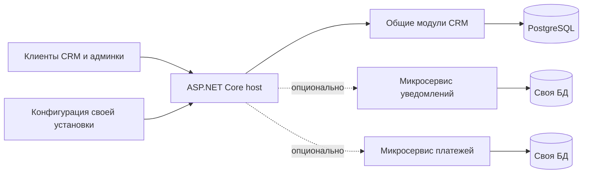

# OpenCRM

**Ядро CRM, на основе которого можно запустить и развивать свой продукт.**

OpenCRM объединяет готовое веб-приложение, общие бизнес-модули, административные интерфейсы и отдельные микросервисы уведомлений и платежей. Начните с базовой CRM, настройте её под свою команду и добавляйте нужные возможности.

## Почему OpenCRM

- **Готовая основа.** Аккаунты, организации, участники, права, клиенты, автомобили, записи, заказы, склад, документы и рабочие финансы.
- **Модульное ядро.** Предметные модули, контракты и инфраструктура разделены по проектам. Общие изменения можно развивать в ядре и переносить в свой продукт через обновления upstream.
- **Отдельные микросервисы.** Уведомления и платежи имеют собственные приложения, настройки, базы данных и Docker-конфигурации. Их можно подключать и разворачивать независимо от основного веб-приложения.
- **Своя настройка.** Название установки, адреса, подключения и провайдеры задаются конфигурацией. Общие компоненты интерфейса переиспользуются клиентскими приложениями.
- **Самостоятельный запуск.** Базовой CRM достаточно PostgreSQL. SMTP, RabbitMQ, ИИ и платёжные провайдеры подключаются по необходимости.
- **Опциональная коммерция.** Тарифы, подписки и промокоды сохранены отдельной возможностью. По умолчанию платные ограничения выключены; членство, роли и проверки прав продолжают действовать.

## Быстрый старт

```bash
git clone https://github.com/eddchervov/OpenCRM.git
cd OpenCRM
```

Далее выполните [инструкцию локального запуска](docs/local-run.md): зависимости, собственная PostgreSQL, строка подключения, сборка, миграции и HTTPS. В ней есть команды для Bash и PowerShell.

После запуска откройте **https://localhost:7142**, зарегистрируйте аккаунт и создайте организацию. Парольный вход по умолчанию работает без почтового сервиса и подтверждения email.

## Документация

| Задача | Руководство |
| --- | --- |
| Запустить CRM с нуля | [Локальный запуск](docs/local-run.md) |
| Настроить свою установку и интеграции | [Конфигурация](docs/configuration.md) |
| Подключить уведомления и платежи | [Микросервисы](docs/microservices.md) |
| Назначить первого администратора и открыть админки | [Администрирование](docs/administration.md) |
| Создать свой продукт и получать обновления ядра | [Надстройки и расширение](docs/extending-opencrm.md) |
| Дорабатывать общее ядро и проверять изменения | [Разработка и вклад в проект](CONTRIBUTING.md) |
| Понять границы модулей | [Архитектура](docs/architecture-current.md) |
| Изменить название и публичные адреса | [Настройки бренда](configuration/README.md) |
| Найти описание конкретной функции | [Указатель документации](docs/README.md) |

## Устройство



- [`src/OpenCRM.WebApp`](src/OpenCRM.WebApp) — HTTP-хост, API и серверные страницы.
- `src/OpenCRM.Modules.*` и `*.Contracts` — предметная логика и контракты модулей.
- `src/OpenCRM.Infrastructure.*` — база данных, хранение файлов и внешние подключения.
- [`src/OpenCRM.Frontend`](src/OpenCRM.Frontend) — сценарные клиенты, веб-админка, настольные административные приложения и общие UI-пакеты.
- [`services/notifications`](services/notifications) и [`services/payments`](services/payments) — самостоятельные микросервисы.
- [`tests`](tests) и `services/*/tests` — модульные и интеграционные проверки.
- [`OpenCRM.sln`](OpenCRM.sln) — основное решение, включая тестовые проекты.

## Свой продукт на основе ядра

Начните с конфигурации: собственная БД, бренд и нужные интеграции. Продуктовые изменения интерфейса и поведения держите отдельно от общих исправлений. Изменения, полезные всем установкам, вносите в OpenCRM; свою версию обновляйте из `upstream/main` и проверяйте перед установкой.

В текущем устройстве новые реализации и модули явно подключаются в хосте и клиентской сборке. Пошаговый процесс, реальные точки расширения и ограничения описаны в [руководстве по надстройкам](docs/extending-opencrm.md).

## Лицензия и авторство

OpenCRM распространяется по [OpenCRM Attribution License 1.0](LICENSE). Разрешены использование, изменение, распространение и коммерческие продукты; собственные доработки можно оставлять закрытыми при соблюдении условий лицензии.

Сохраняйте уведомление об авторстве и видимую подпись на сайте или в веб-интерфейсе:

> На базе OpenCRM · автор [eddchervov](https://github.com/eddchervov)

Условие действует и при изменении названия или оформления своего продукта. Полные условия находятся в `LICENSE`; сторонние компоненты сохраняют свои лицензии.
