# OpenCRM

**English** | [Русский](README.ru.md)

**A CRM core you can use to launch and grow your own product.**

OpenCRM combines a working web application, shared business modules, administration interfaces, and independent notification and payment microservices. Start with the core CRM, configure it for your team, and extend it with the features you need.

## CRM interface

Real screenshots from a local OpenCRM installation with fictitious demonstration data and commercial mode disabled. The interface shown is Russian; both documentation languages share the same images.

Expand a section below to explore that screen without leaving this README.

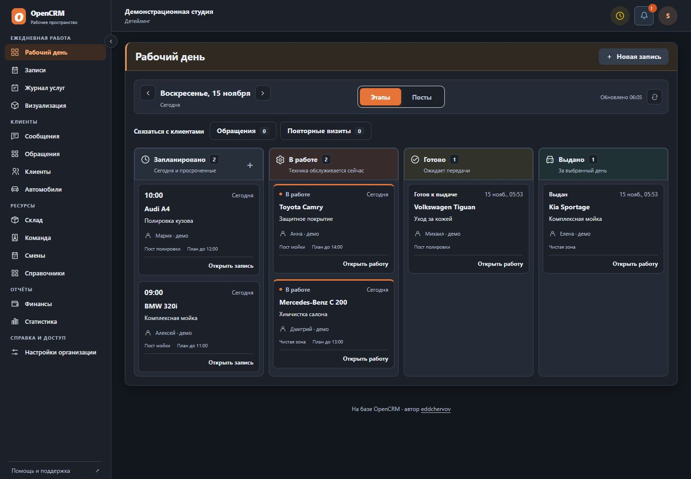

<details>
<summary><strong>Workday — light theme</strong></summary>

The same four-stage workday in light theme.

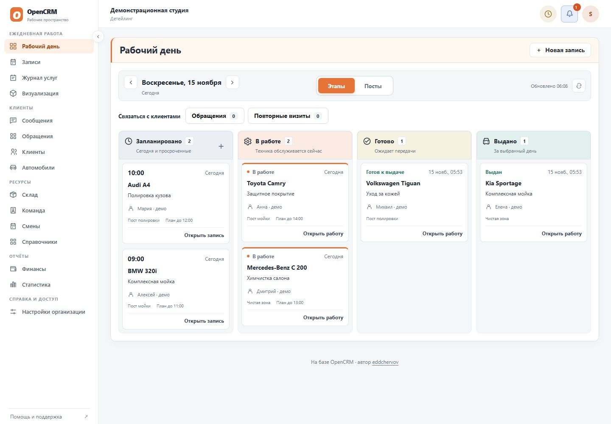

</details>

<details>
<summary><strong>Customers — search, filters, and visit history</strong></summary>

Customer records, vehicles, and service history in one list.

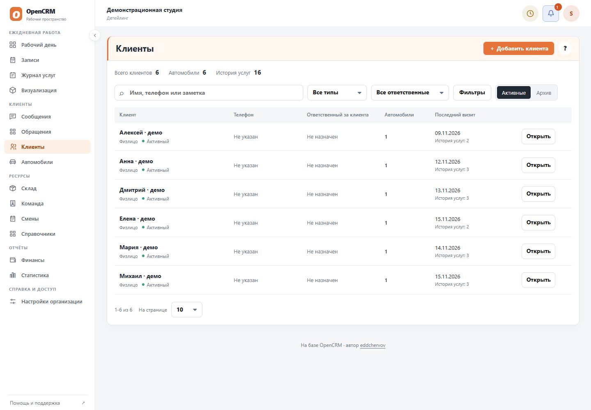

</details>

<details>
<summary><strong>Appointments — work-bay schedule</strong></summary>

Planned and active orders on the time grid for three work areas.

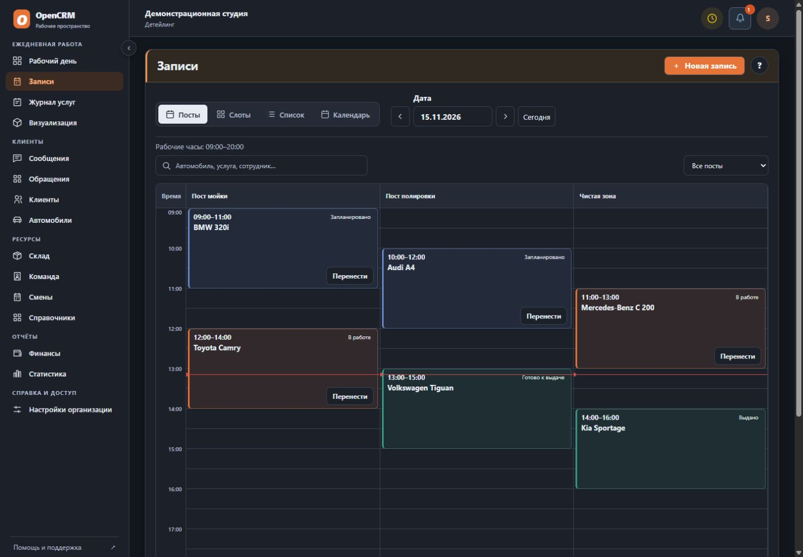

</details>

<details>
<summary><strong>Work order — services and payment summary</strong></summary>

Vehicle, workflow stage, service lines, customer, and payment summary.

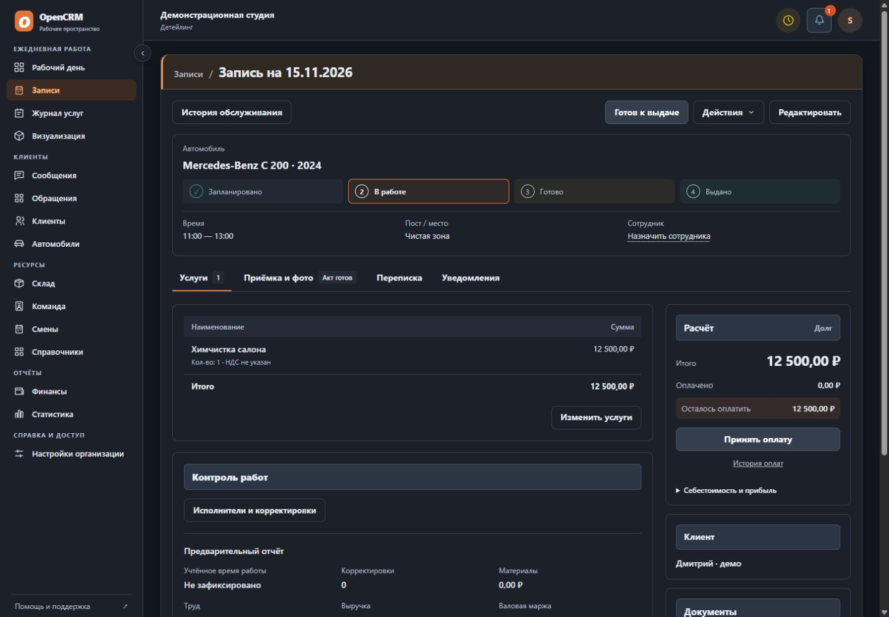

</details>

<details>
<summary><strong>Intake — condition, damage diagram, and documents</strong></summary>

Four vehicle projections with a damage marker and document actions.

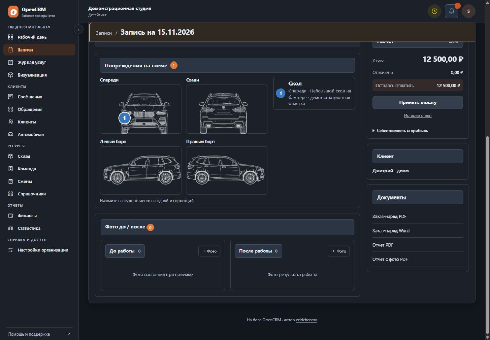

</details>

<details>
<summary><strong>Inquiries — four-stage board</strong></summary>

Follow a request from first contact to readiness for an appointment.


</details>

<details>
<summary><strong>Inquiry record — next action and history</strong></summary>

Customer interest, the next action, notes, and event history.

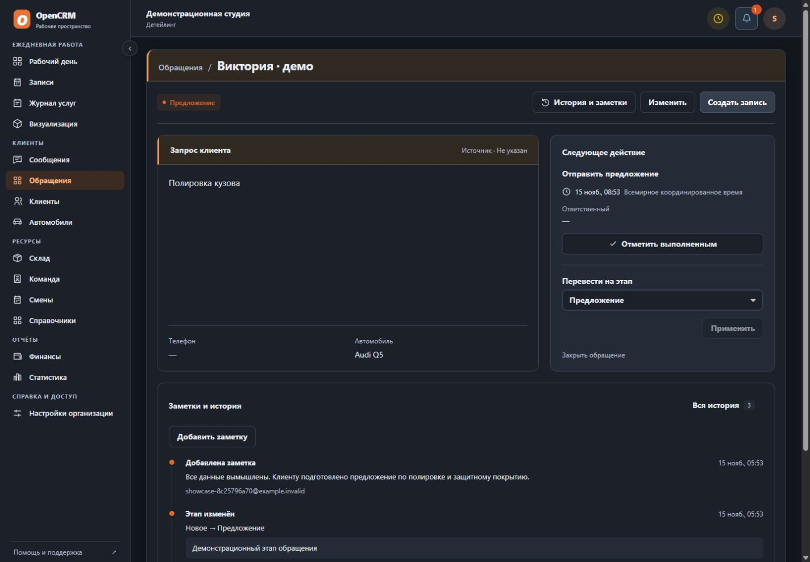

</details>

<details>
<summary><strong>Statistics — metrics and work charts</strong></summary>

Operational organization metrics, completed work, and amounts.

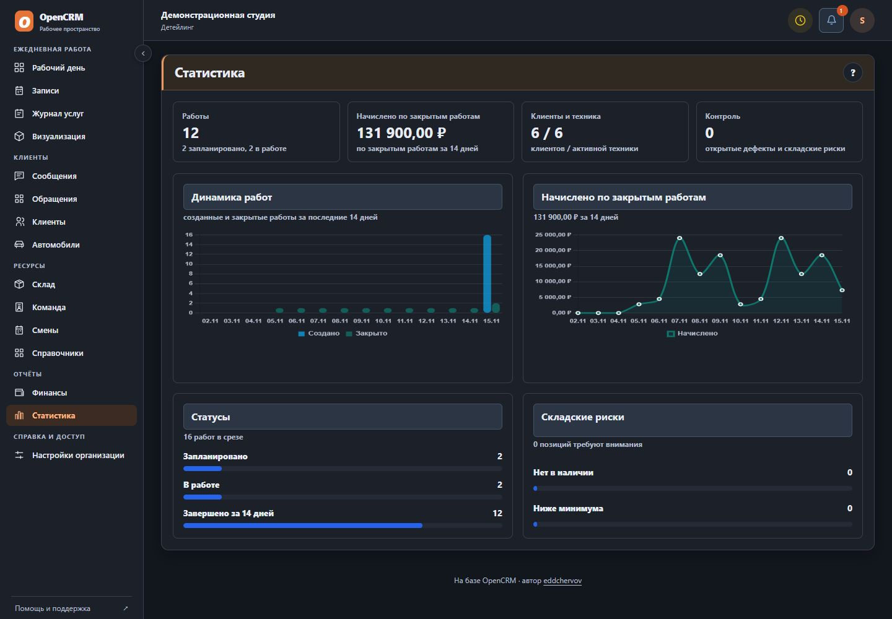

</details>

<details>
<summary><strong>Roles and permissions — access by role</strong></summary>

Role selection and permission search; the example shows employee access to customers.

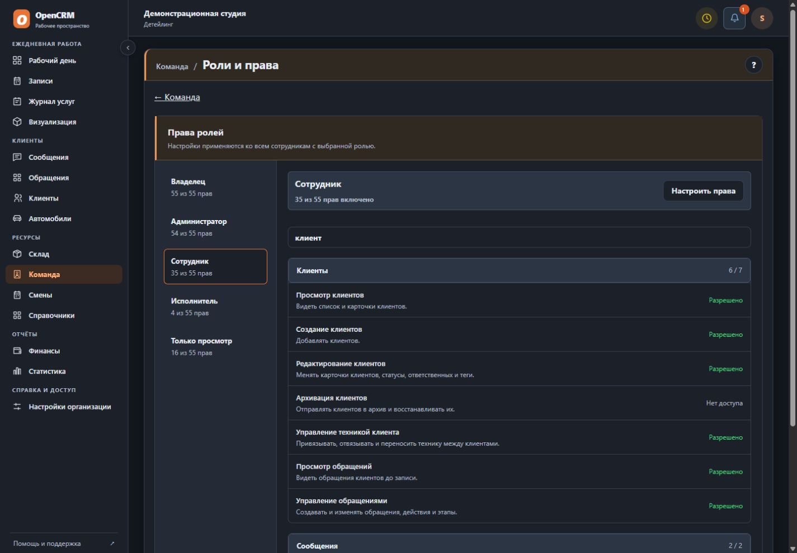

</details>

<details>
<summary><strong>Public pages — home and sign-in</strong></summary>

A neutral home page and an empty password sign-in form for a self-hosted installation.

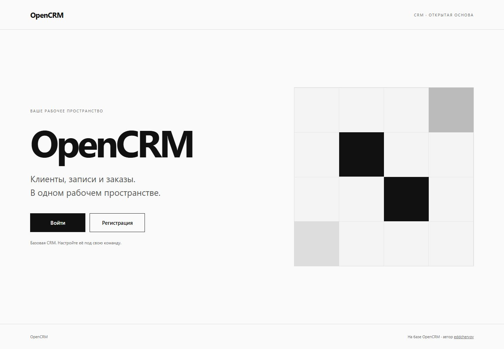

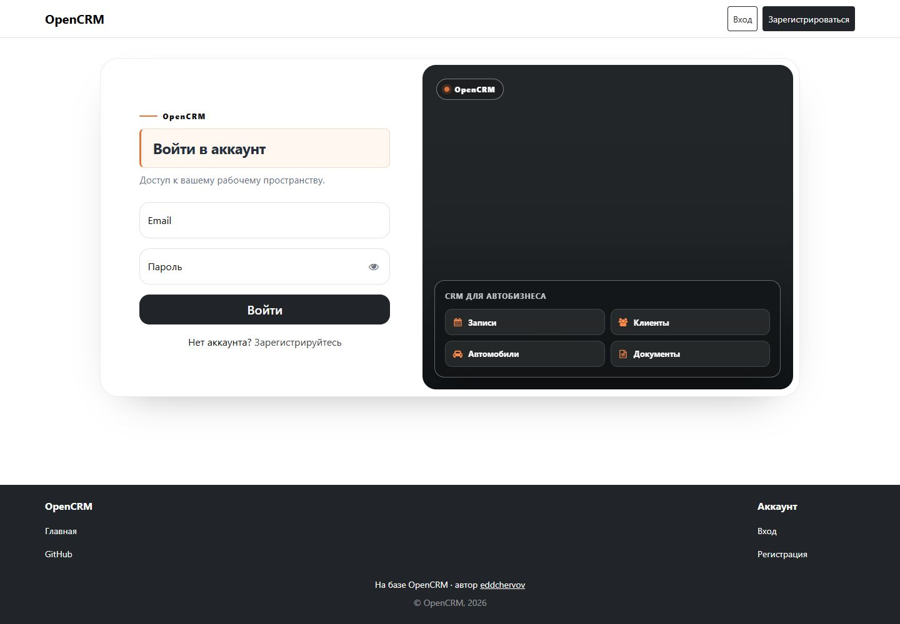

</details>

[Open the full gallery with captions](docs/screenshots.md).

## Why OpenCRM

- **A working foundation.** Accounts, organizations, membership, permissions, customers, vehicles, appointments, work orders, inventory, documents, and operational finances.
- **A modular core.** Business modules, contracts, and infrastructure are organized into separate projects. Improvements to shared functionality can be developed in the core and brought into your product through upstream updates.
- **Independent microservices.** Notifications and payments have their own applications, configuration, databases, and Docker setup. You can connect and deploy them independently of the main web application.
- **Your own configuration.** Set your installation name, URLs, connections, and providers through configuration. Shared UI components are reused across client applications.
- **Self-hosted operation.** The basic CRM only needs PostgreSQL. SMTP, RabbitMQ, AI, and payment providers are optional integrations.
- **Optional commercial features.** Plans, subscriptions, and promotional codes remain available as an optional capability. Paid restrictions are disabled by default; membership, roles, and permission checks remain enforced.

## Quick start

```bash
git clone https://github.com/eddchervov/OpenCRM.git
cd OpenCRM
```

Follow the [local setup guide](docs/local-run.md) for dependencies, your own PostgreSQL instance, connection configuration, build commands, migrations, and HTTPS. It includes commands for Bash and PowerShell.

Once the application is running, open **https://localhost:7142**, register an account, and create an organization. By default, password sign-in does not require an email service or email verification.

## Documentation

All project guides are available in English and Russian. Use the language links at the top of each document; navigation stays in the selected language. Code samples and screenshots preserve their original content.

| Task | Guide |
| --- | --- |
| Run the CRM from scratch | [Local setup](docs/local-run.md) |
| Configure your installation and integrations | [Configuration](docs/configuration.md) |
| Connect notifications and payments | [Microservices](docs/microservices.md) |
| Assign the first administrator and access the admin interfaces | [Administration](docs/administration.md) |
| Build your product and receive core updates | [Customization and extensions](docs/extending-opencrm.md) |
| Develop the shared core and validate changes | [Contributing](CONTRIBUTING.md) |
| Understand module boundaries | [Architecture](docs/architecture-current.md) |
| Change the installation name and public URLs | [Brand configuration](configuration/README.md) |
| Find documentation for a particular feature | [Documentation index](docs/README.md) |

## Architecture

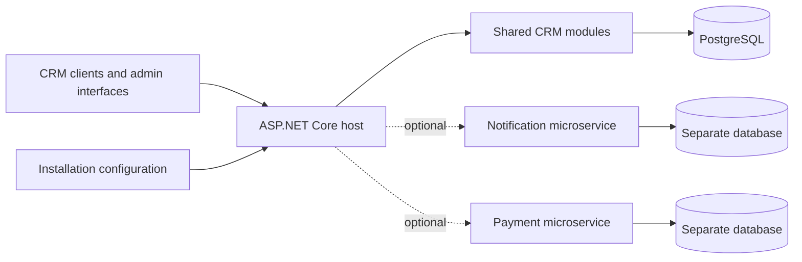

- [`src/OpenCRM.WebApp`](src/OpenCRM.WebApp) — HTTP host, API, and server-rendered pages.
- `src/OpenCRM.Modules.*` and `*.Contracts` — business logic and module contracts.
- `src/OpenCRM.Infrastructure.*` — database access, file storage, and external connections.
- [`src/OpenCRM.Frontend`](src/OpenCRM.Frontend) — scenario clients, web administration, desktop administration applications, and shared UI packages.
- [`services/notifications`](services/notifications) and [`services/payments`](services/payments) — independent microservices.
- [`tests`](tests) and `services/*/tests` — unit and integration tests.
- [`OpenCRM.sln`](OpenCRM.sln) — the main solution, including the test projects.

## Build your product on the core

Start with configuration: your own database, branding, and integrations. Keep product-specific interface and behavior changes separate from shared fixes. Contribute improvements that benefit all installations to OpenCRM; update your product from `upstream/main` and validate it before deployment.

In the current architecture, new implementations and modules are explicitly registered in the host and client build. See the [customization guide](docs/extending-opencrm.md) for the workflow, available extension points, and limitations.

## Built on OpenCRM

[I-MOTORIST.RU](https://i-motorist.ru/) is a product built on the OpenCRM core, focused on detailing studios and automotive repair shops. It illustrates how the shared CRM foundation can be adapted with product-specific branding, public pages, and configuration.

## License and attribution

OpenCRM is distributed under the [OpenCRM Attribution License 1.0](LICENSE). It permits use, modification, redistribution, and commercial products; your own modifications may remain private provided you comply with the license conditions.

Keep the copyright notice and the required visible attribution on your website or web interface:

> На базе OpenCRM · автор [eddchervov](https://github.com/eddchervov)

The line means “Powered by OpenCRM · author eddchervov.” The attribution requirement also applies if you rename or redesign your product. See `LICENSE` for the full terms; third-party components retain their own licenses.
