# OpenCRM

[English](README.md) | **Русский**

**Ядро CRM, на основе которого можно запустить и развивать свой продукт.**

OpenCRM объединяет готовое веб-приложение, общие бизнес-модули, административные интерфейсы и отдельные микросервисы уведомлений и платежей. Начните с базовой CRM, настройте её под свою команду и добавляйте нужные возможности.

## Интерфейс CRM

Настоящие снимки локальной OpenCRM с вымышленными демонстрационными данными и выключенным коммерческим режимом. Обе языковые версии документации используют общие изображения.

Раскрывайте нужные разделы ниже, чтобы посмотреть каждый экран прямо в README.

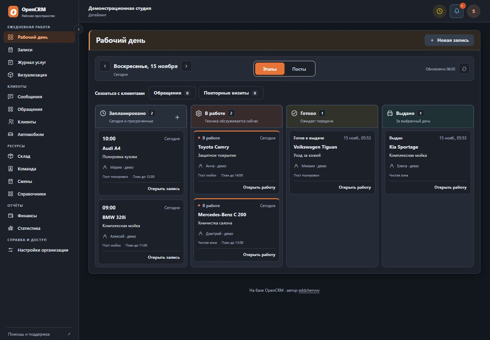

<details>
<summary><strong>Рабочий день — светлая тема</strong></summary>

Тот же рабочий день с четырьмя этапами в светлой теме.

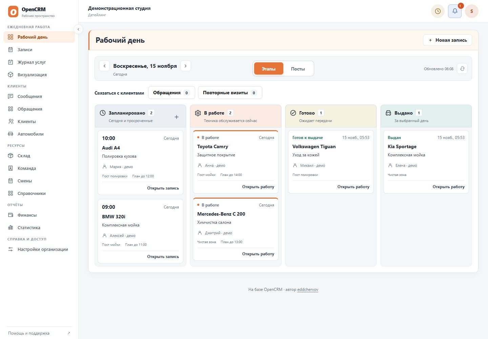

</details>

<details>
<summary><strong>Клиенты — поиск, фильтры и история визитов</strong></summary>

Клиентская база, автомобили и история услуг в одном списке.

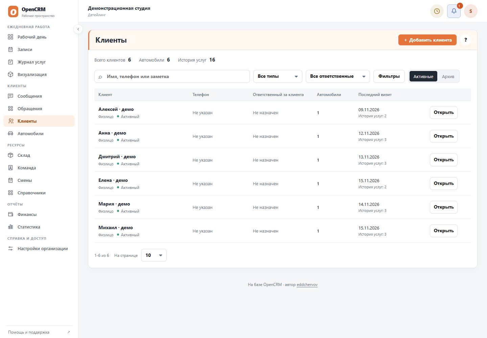

</details>

<details>
<summary><strong>Записи — расписание по постам</strong></summary>

Плановые и текущие заказы на временной сетке трёх рабочих зон.

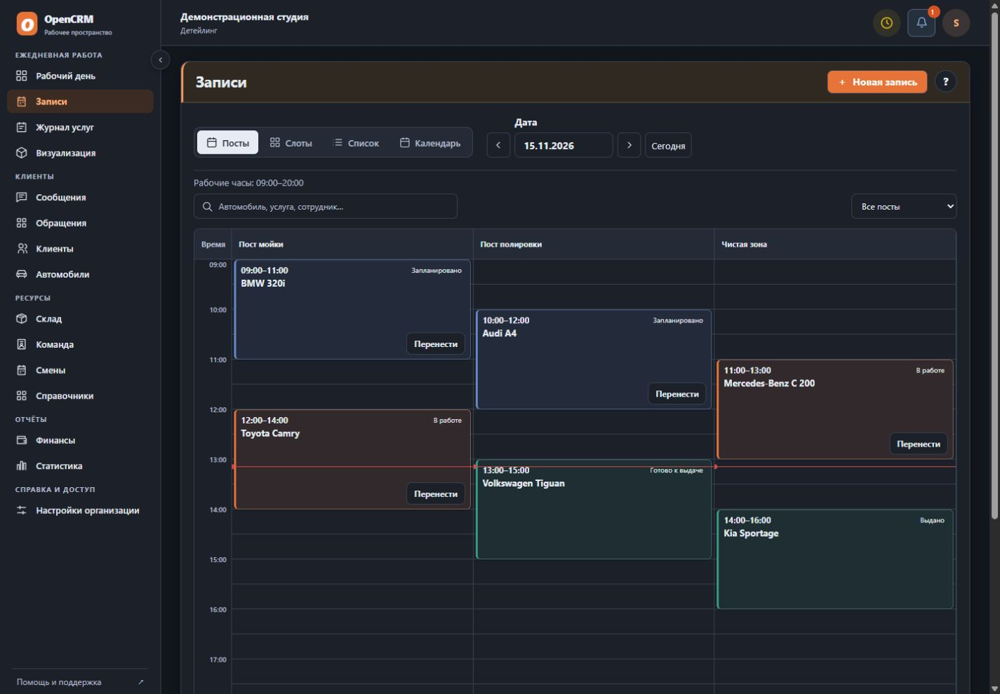

</details>

<details>
<summary><strong>Заказ — услуги и расчёты</strong></summary>

Автомобиль, этап работы, состав услуг, клиент и расчёты.

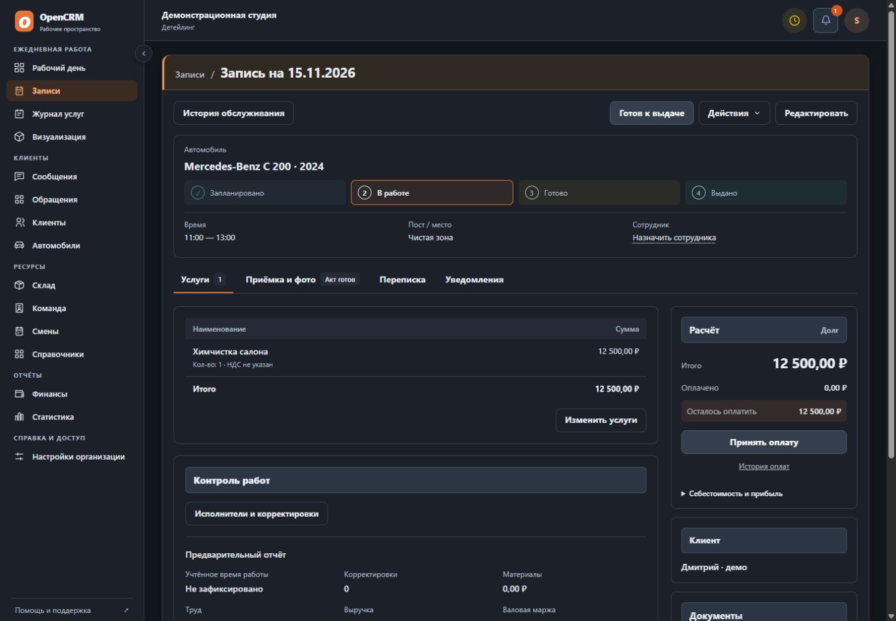

</details>

<details>
<summary><strong>Приёмка — состояние, схема повреждений и документы</strong></summary>

Четыре проекции автомобиля с отметкой повреждения и документами.

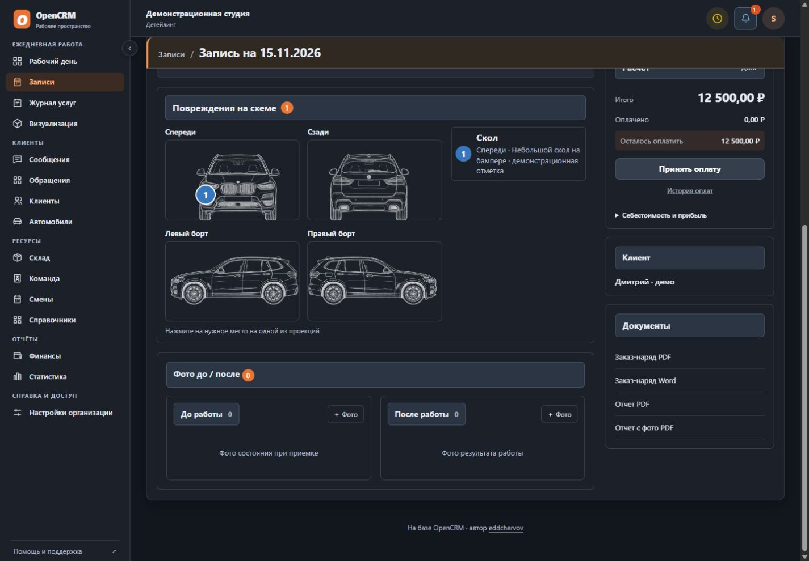

</details>

<details>
<summary><strong>Обращения — доска с четырьмя этапами</strong></summary>

Путь обращения от первого контакта до готовности к записи.


</details>

<details>
<summary><strong>Карточка обращения — следующее действие и история</strong></summary>

Запрос клиента, следующее действие, заметки и история событий.


</details>

<details>
<summary><strong>Статистика — показатели и графики работ</strong></summary>

Рабочие показатели организации, выполненные работы и суммы.

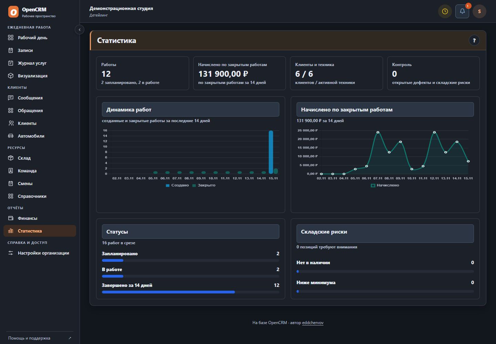

</details>

<details>
<summary><strong>Роли и права — доступ по ролям</strong></summary>

Выбор роли и поиск разрешений; в примере показан доступ сотрудника к клиентам.

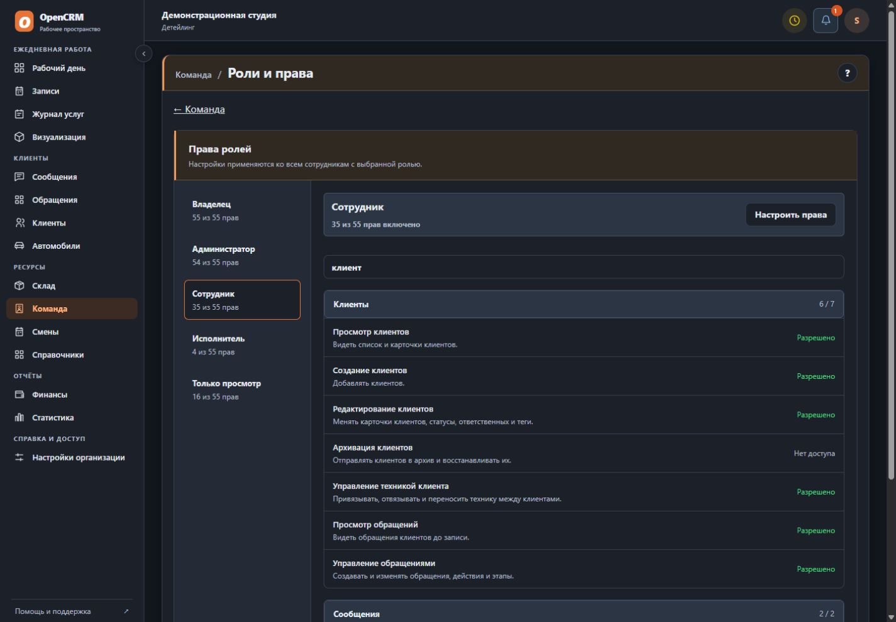

</details>

<details>
<summary><strong>Публичные страницы — главная и вход</strong></summary>

Нейтральная главная и незаполненная форма парольного входа для собственной установки.

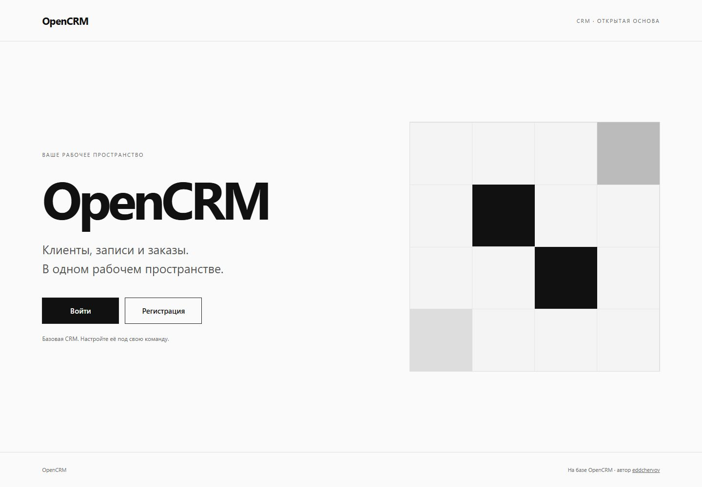

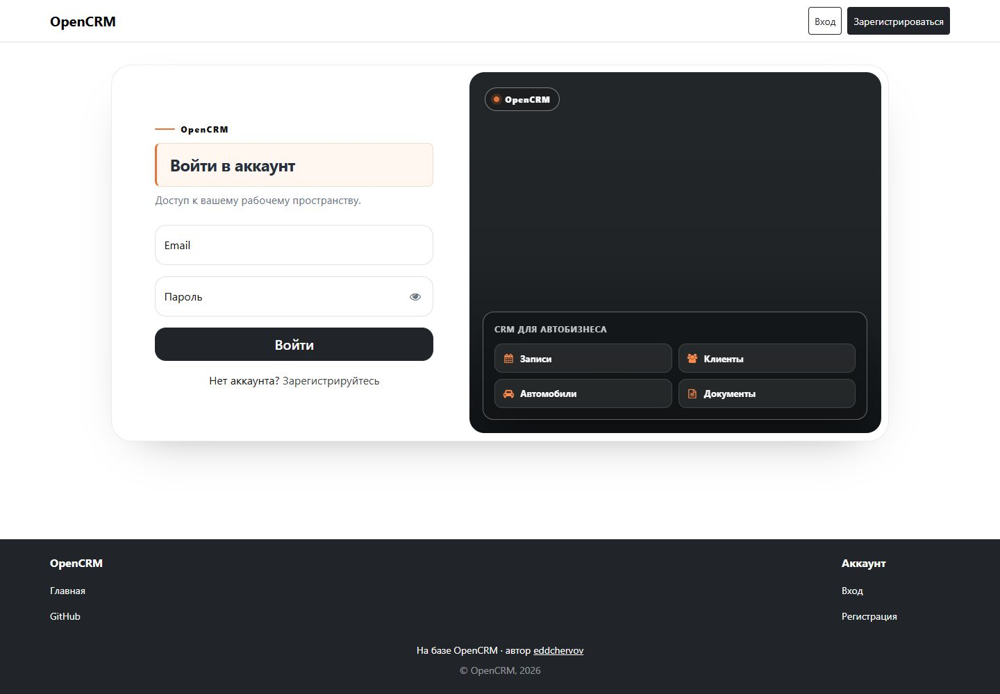

</details>

[Открыть полную галерею с пояснениями](docs/screenshots.ru.md).

## Почему OpenCRM

- **Готовая основа.** Аккаунты, организации, участники, права, клиенты, автомобили, записи, заказы, склад, документы и рабочие финансы.
- **Модульное ядро.** Предметные модули, контракты и инфраструктура разделены по проектам. Общие изменения можно развивать в ядре и переносить в свой продукт через обновления upstream.
- **Отдельные микросервисы.** Уведомления и платежи имеют собственные приложения, настройки, базы данных и Docker-конфигурации. Их можно подключать и разворачивать независимо от основного веб-приложения.
- **Своя настройка.** Название установки, адреса, подключения и провайдеры задаются конфигурацией. Общие компоненты интерфейса переиспользуются клиентскими приложениями.
- **Самостоятельный запуск.** Базовой CRM достаточно PostgreSQL. SMTP, RabbitMQ, ИИ и платёжные провайдеры подключаются по необходимости.
- **Опциональная коммерция.** Тарифы, подписки и промокоды сохранены отдельной возможностью. По умолчанию платные ограничения выключены; членство, роли и проверки прав продолжают действовать.

## Быстрый старт

```bash
git clone https://github.com/eddchervov/OpenCRM.git
cd OpenCRM
```

Далее выполните [инструкцию локального запуска](docs/local-run.ru.md): зависимости, собственная PostgreSQL, строка подключения, сборка, миграции и HTTPS. В ней есть команды для Bash и PowerShell.

После запуска откройте **https://localhost:7142**, зарегистрируйте аккаунт и создайте организацию. Парольный вход по умолчанию работает без почтового сервиса и подтверждения email.

## Документация

| Задача | Руководство |
| --- | --- |
| Запустить CRM с нуля | [Локальный запуск](docs/local-run.ru.md) |
| Настроить свою установку и интеграции | [Конфигурация](docs/configuration.ru.md) |
| Подключить уведомления и платежи | [Микросервисы](docs/microservices.ru.md) |
| Назначить первого администратора и открыть админки | [Администрирование](docs/administration.ru.md) |
| Создать свой продукт и получать обновления ядра | [Надстройки и расширение](docs/extending-opencrm.ru.md) |
| Дорабатывать общее ядро и проверять изменения | [Разработка и вклад в проект](CONTRIBUTING.ru.md) |
| Понять границы модулей | [Архитектура](docs/architecture-current.ru.md) |
| Изменить название и публичные адреса | [Настройки бренда](configuration/README.ru.md) |
| Найти описание конкретной функции | [Указатель документации](docs/README.ru.md) |

## Устройство

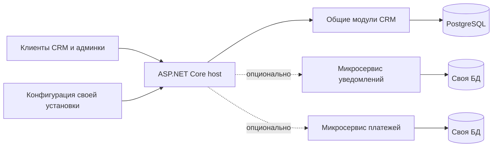

- [`src/OpenCRM.WebApp`](src/OpenCRM.WebApp) — HTTP-хост, API и серверные страницы.
- `src/OpenCRM.Modules.*` и `*.Contracts` — предметная логика и контракты модулей.
- `src/OpenCRM.Infrastructure.*` — база данных, хранение файлов и внешние подключения.
- [`src/OpenCRM.Frontend`](src/OpenCRM.Frontend) — сценарные клиенты, веб-админка, настольные административные приложения и общие UI-пакеты.
- [`services/notifications`](services/notifications) и [`services/payments`](services/payments) — самостоятельные микросервисы.
- [`tests`](tests) и `services/*/tests` — модульные и интеграционные проверки.
- [`OpenCRM.sln`](OpenCRM.sln) — основное решение, включая тестовые проекты.

## Свой продукт на основе ядра

Начните с конфигурации: собственная БД, бренд и нужные интеграции. Продуктовые изменения интерфейса и поведения держите отдельно от общих исправлений. Изменения, полезные всем установкам, вносите в OpenCRM; свою версию обновляйте из `upstream/main` и проверяйте перед установкой.

В текущем устройстве новые реализации и модули явно подключаются в хосте и клиентской сборке. Пошаговый процесс, реальные точки расширения и ограничения описаны в [руководстве по надстройкам](docs/extending-opencrm.ru.md).

## Пример продукта на базе OpenCRM

[I-MOTORIST.RU](https://i-motorist.ru/) — продукт на базе ядра OpenCRM для детейлинг-студий и автосервисов. Это пример адаптации общей CRM-основы: собственный бренд, публичные страницы и настройки продукта.

## Лицензия и авторство

OpenCRM распространяется по [OpenCRM Attribution License 1.0](LICENSE). Разрешены использование, изменение, распространение и коммерческие продукты; собственные доработки можно оставлять закрытыми при соблюдении условий лицензии.

Сохраняйте уведомление об авторстве и условия лицензии в копиях программы. На сайте или в веб-интерфейсе размещайте подпись:

> На базе [OpenCRM](https://github.com/eddchervov/OpenCRM)

Автор OpenCRM: [eddchervov](https://github.com/eddchervov). В интерфейсе достаточно названия ядра и ссылки на репозиторий; имя автора и ссылка на его профиль там не обязательны. Условие действует и при изменении названия или оформления своего продукта. Полные условия находятся в `LICENSE`; сторонние компоненты сохраняют свои лицензии.
