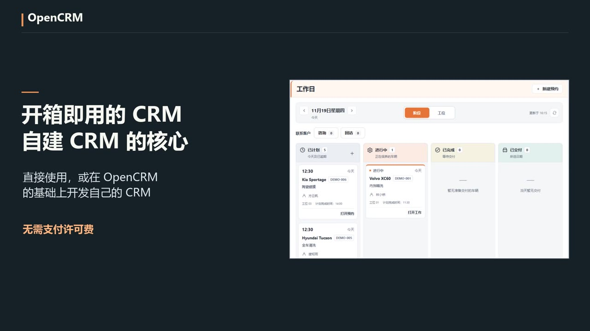
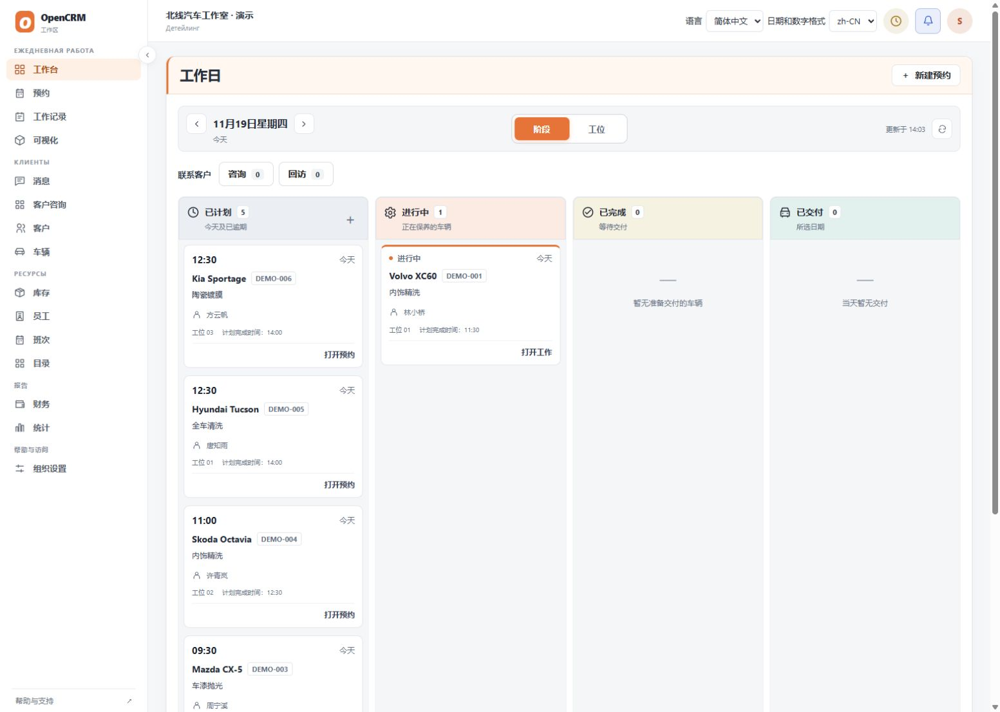
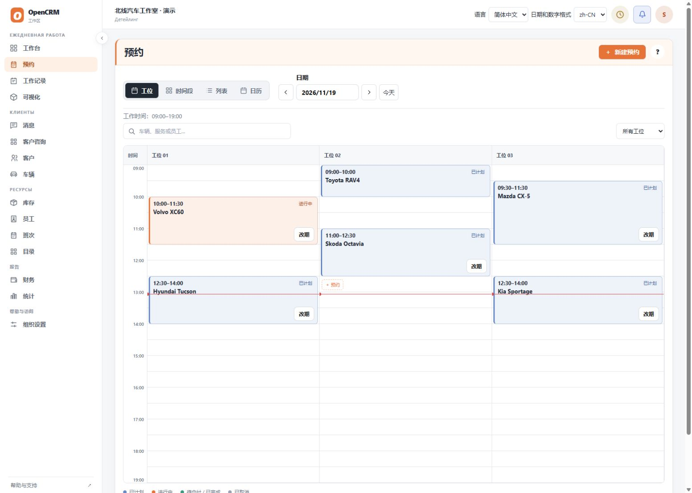
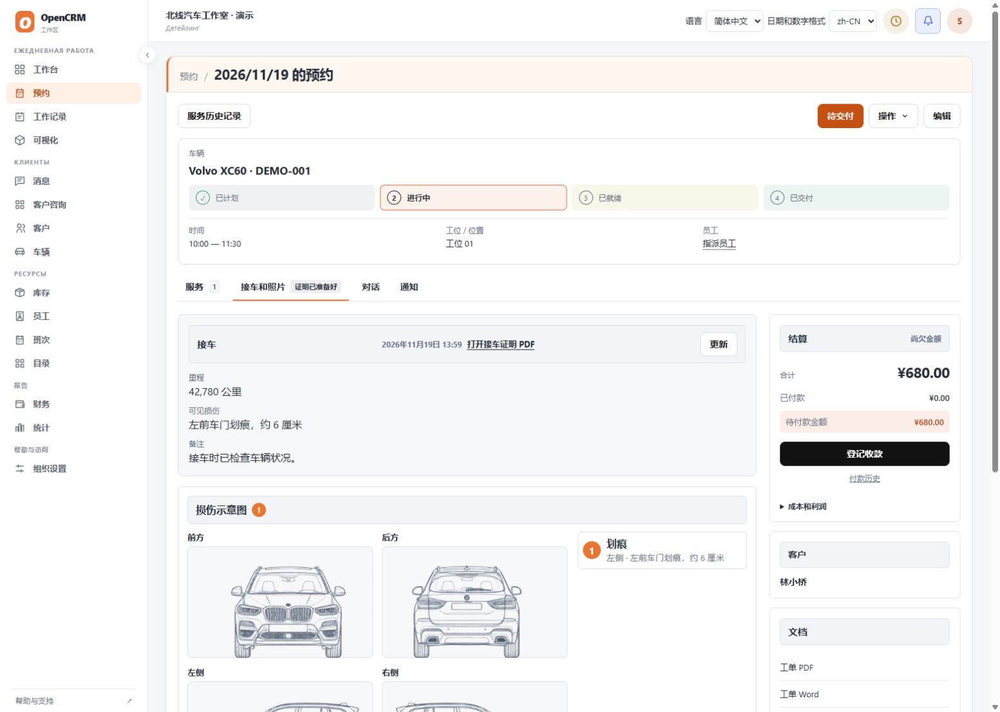
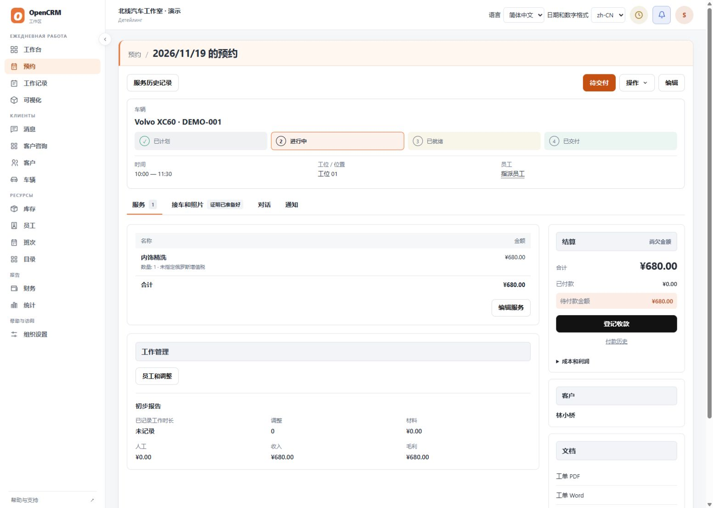
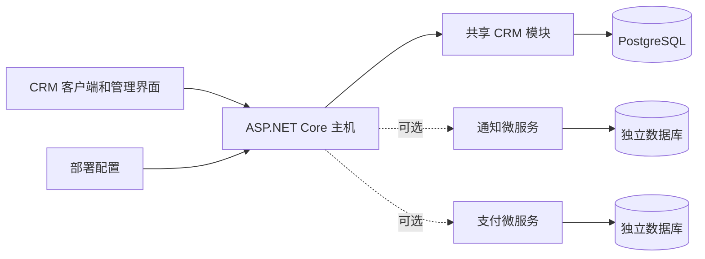

# OpenCRM

[English](README.md) | [Русский](README.ru.md) | **简体中文**

**开箱即用的汽车服务 CRM，也可作为自建 CRM 的模块化核心。支持自行部署，无需支付许可费。**

[观看演示](#视频演示) · [自行部署](docs/local-run.zh-CN.md) · [构建自己的 CRM](docs/extending-opencrm.zh-CN.md)

OpenCRM 为汽车美容门店和维修厂提供客户、车辆、工位预约、接车检查和维修工单管理。车队管理团队也可以用它作为自建车辆台账和维保工具的基础。应用部署在自己的服务器上，团队可以配置品牌和集成，并按业务需要扩展代码。

## 视频演示

[](https://www.youtube.com/watch?v=cxJ-XmhH_Pg)

[在 YouTube 观看（2 分 30 秒）](https://www.youtube.com/watch?v=cxJ-XmhH_Pg)。跟随一次汽车美容服务，了解从客户预约到车辆交付的完整流程。

## 界面预览

截图来自本地运行的 OpenCRM。界面为简体中文，虚构门店以人民币（CNY）记账。演示车牌以 `DEMO-` 开头，电话和车辆识别代号（VIN）留空。



<details>
<summary>工位预约排班</summary>

三个工位上安排了六条演示预约。



</details>

<details>
<summary>接车与损伤示意图</summary>

沃尔沃 XC60 的接车记录标记了左侧的一处划痕。



</details>

<details>
<summary>维修工单</summary>

工单显示服务项目、当前阶段和人民币应收金额。



</details>

[查看完整截图和说明](docs/screenshots.zh-CN.md)

## 开箱即用与扩展

- **日常业务。** 管理账户、组织、成员和权限，以及客户、车辆、预约、工单、库存、单据和经营收支。
- **模块化核心。** 业务模块、接口契约和基础设施分布在独立项目中。通用改进可以从上游同步到自己的产品。
- **独立服务。** 通知和支付各自拥有应用、配置、数据库和 Docker 部署，可按需接入。基本 CRM 运行依赖 PostgreSQL，SMTP、RabbitMQ、AI 和支付服务均为可选项。
- **自主配置。** 可设置部署名称、网址、连接和服务提供方。各客户端复用通用界面组件。
- **可选商业功能。** 系统保留套餐、订阅和优惠码功能。付费限制默认关闭，成员资格、角色和权限检查仍然生效。

## 快速开始

```bash
git clone https://github.com/eddchervov/OpenCRM.git
cd OpenCRM
```

按[本地部署指南](docs/local-run.zh-CN.md)安装依赖、配置 PostgreSQL、运行数据库迁移并启动应用。指南包含 Bash 和 PowerShell 命令。

启动后访问 **https://localhost:7142**，注册账号并创建组织。默认配置下，密码登录无需邮件服务或邮箱验证。

## 付费部署与技术支持

OpenCRM 作者提供在您自己的服务器上部署 OpenCRM 的付费服务和技术支持。如需沟通需求和费用，请发邮件至 [wiji.ed@mail.ru](mailto:wiji.ed@mail.ru)。

## 文档

从[简体中文文档索引](docs/README.zh-CN.md)查找部署、管理、扩展和业务模块的资料。每页顶部的语言链接可切换版本。部分技术页面为机器译稿，原文可用于核对术语、接口和部署步骤。

## 架构



- [`src/OpenCRM.WebApp`](src/OpenCRM.WebApp) 提供 HTTP 主机、API 和服务端渲染页面。
- `src/OpenCRM.Modules.*` 和 `*.Contracts` 包含业务逻辑和模块契约。
- `src/OpenCRM.Infrastructure.*` 提供数据库访问、文件存储和外部连接。
- [`src/OpenCRM.Frontend`](src/OpenCRM.Frontend) 包含各业务客户端、Web 管理端、桌面管理应用和共享界面组件。
- [`services/notifications`](services/notifications) 和 [`services/payments`](services/payments) 是独立的通知和支付微服务。
- [`OpenCRM.sln`](OpenCRM.sln) 包含主项目及测试项目。单元测试和集成测试位于 [`tests`](tests) 和 `services/*/tests`。

## 基于 OpenCRM 构建自己的产品

先配置自己的数据库、品牌和集成。将产品专属的界面和行为放在产品一侧，将可供其他部署使用的修复提交给 OpenCRM。从 `upstream/main` 同步更新并在部署前验证。新增模块需要在主机和客户端构建中显式注册。详细流程和扩展点见[定制与扩展指南](docs/extending-opencrm.zh-CN.md)。

## 许可与署名

OpenCRM 采用 [OpenCRM Attribution License 1.0](LICENSE)。遵守许可条件即可使用、修改、再分发或用于商业产品，也可以保留私有修改。

软件副本须保留版权和许可声明。网站或 Web 界面须显示指向本仓库的 OpenCRM 项目名称，例如：

> 基于 [OpenCRM](https://github.com/eddchervov/OpenCRM)

更改产品名称或界面后仍须保留上述署名。界面无需显示作者姓名或个人主页链接。作者为 [eddchervov](https://github.com/eddchervov)。第三方组件沿用各自的许可。完整条款见 `LICENSE`。
