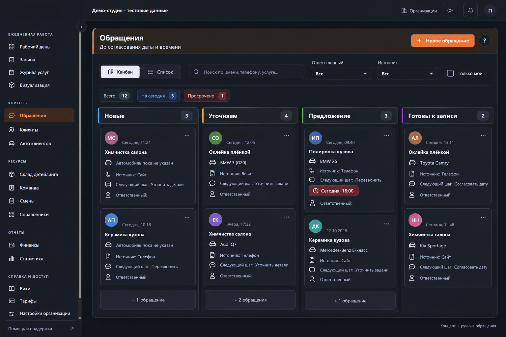
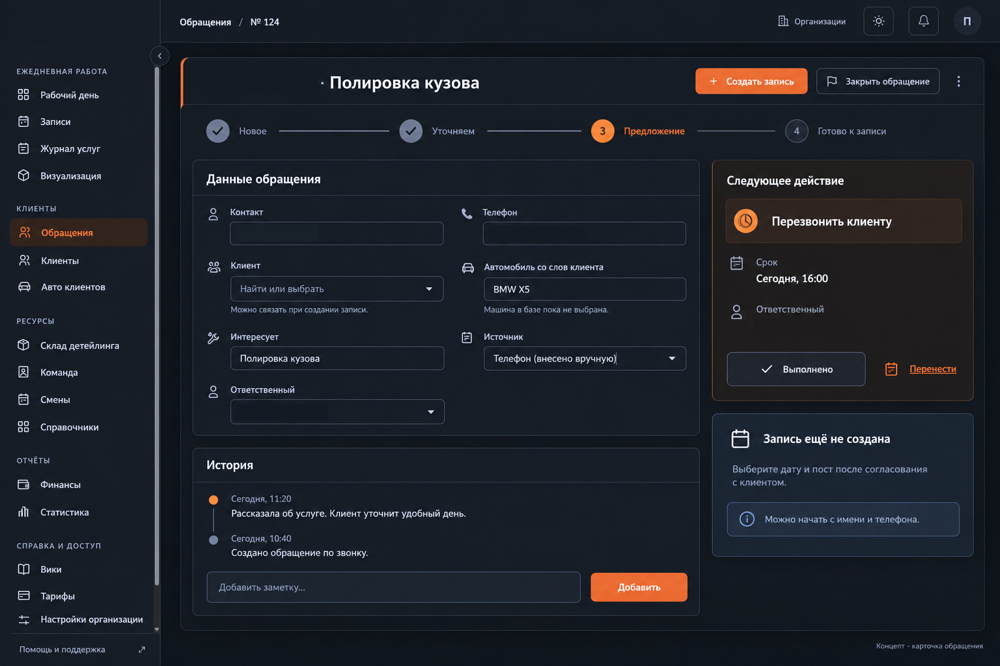
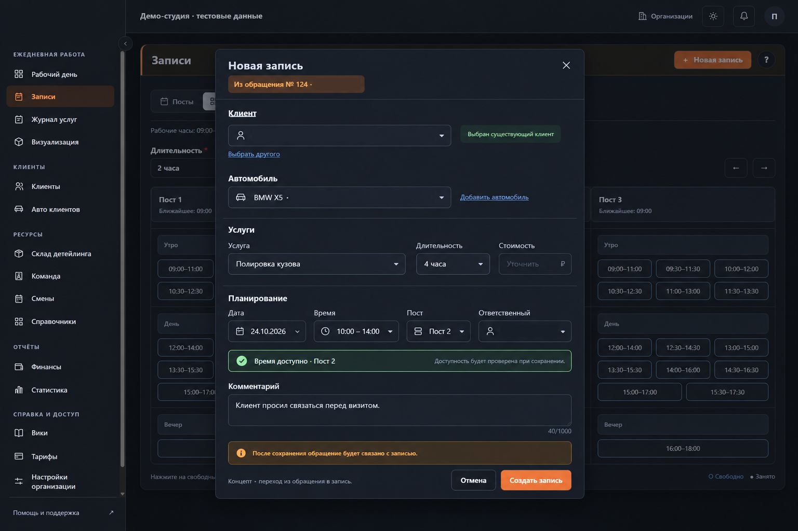
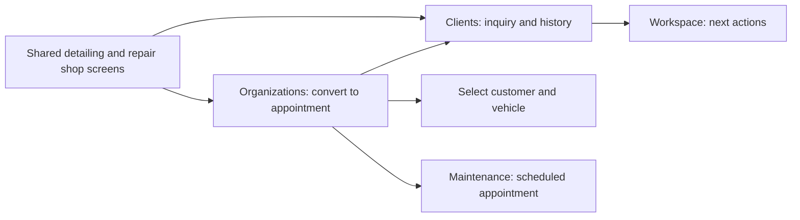

# Manual Inquiries Before Booking: Phase Two Design

**English** | [Русский](inquiries-design.ru.md)

This document describes handling inquiries before an appointment is created. API contracts, data storage, and migration constraints are in the [implementation document](inquiries-implementation.md).

## User workflow

A customer asks about polishing → an administrator records an inquiry → clarifies the scope and arranges a call → selects a service, vehicle, and time → creates an appointment. An inquiry can exist without a registered customer or vehicle. Saving an inquiry or moving it to “Ready to book” does not reserve a bay.

Open stages: “New,” “Clarifying,” “Proposal,” and “Ready to book.” Terminal outcomes: “Booked,” linked to an appointment, or “Closed,” with a reason. Later cancellation or completion of the work order must not rewrite inquiry history.

The user can start with a name or another contact label and a description of the customer's interest; a known phone number is saved immediately. A usable contact method is needed to continue the conversation, but a visitor without a phone number must still be able to make a manual inquiry. Required form fields are finalized during implementation. The assignee must be an active member of the selected organization.

## Three screens

### Inquiries

A new item in the existing “Customers” group. The board and list show the same data; filters include assignee, source, stage, and next-action due date. Closed and booked items are available through a filter. On phones, the primary view is a compact list. Stage changes must work by button and keyboard; drag-and-drop is not required for the first release.

The server calculates counts and pages from inquiries the current user may access in the selected organization. The board needs separate counts and bounded batches of cards per stage, rather than loading the entire database into the browser. “Website” or “Phone” on a card is a manually selected source, not a connected channel.

### Profile

The left side contains the contact, interest, source, selected relationships, and history; the right side contains one next action, its due date, and the assignee. A vehicle description provided by the customer is distinct from a vehicle selected from the database. A call note is just a note; it does not mean a message was sent or a phone call was recorded.

A name and phone number without a customer-profile link are stored on the inquiry. When creating an appointment, an administrator explicitly selects a matching customer or explicitly creates a new one using the existing duplicate check. The system must not treat a matching phone number as proof of identity or relink an existing vehicle when its customer changes.

### Create appointment

The button opens the existing form with inquiry context. The form is prefilled with the customer, contact, selected vehicle, interest description, and note. Free-text interest is not automatically converted into a catalog service with an invented price or duration; an administrator confirms the service. Existing server-side availability and access checks apply after a time is selected.

The inquiry assignee does not automatically become the worker or a notification recipient. The assignee field in the mockup illustrates manager context; its exact placement in the form is decided during implementation. Payer and vehicle-owner behavior keep their existing separate rules.

The mockups were generated using the accepted dark OpenCRM interface; their exact grid and labels are not a production contract. Implementation must support light theme and mobile layout. All contacts, vehicles, services, and dates are demonstration data. The illustrations describe a user workflow and do not prescribe the branding of a particular installation.

## Module ownership and relationships

Keep the modular monolith, shared `OpenCRMContext`, and PostgreSQL. Inquiries do not need a new standalone application or microservice.

| Area | Proposed responsibility |
| --- | --- |
| `OpenCRM.Modules.Clients`, `Inquiries` area | Inquiries, stages, notes, assignee, next action, and link to the result. Contracts live in the existing `OpenCRM.Modules.Clients.Contracts`. |
| `OpenCRM.Modules.Organizations/Bookings` | Coordinate inquiry conversion using existing customer, vehicle, and work-order services. |
| `OpenCRM.Modules.Maintenance` | Own the work order, service rows, execution status, and later payments. Do not introduce a second CRM order type. |
| `OpenCRM.Modules.Workspace` | Menu item, permission-filtered counts, and next-action block in Workday. |
| `packages/workspace` | Shared inquiry components and API for detailing and auto service; scenario shells retain their appointment-form differences. |

Inquiry implementation must not depend on another module’s implementation. The booking coordinator uses the Clients contract to lock/check the inquiry and save its relationship in the shared transaction. Contracts do not return EF entities, `DbContext`, or `IQueryable`. Calls must follow the existing boundaries described in the [current architecture](architecture-current.md).

## Data

Two new tables should be sufficient; names are provisional.

- `OrganizationInquiries`: identifier and organization, contact and phone, optional customer and vehicle foreign keys, customer-provided vehicle description, requested work, source code, stage, assignee, next-action text and due date, closure reason, optional created-maintenance foreign key, version, creation and update timestamps.
- `OrganizationInquiryEvents`: inquiry foreign key, author, timestamp, event type, and note text or historical values of a change. Creation, stage and assignee changes, due-date changes, action completion, closure, and conversion are recorded.

Mutable relationships belong in foreign-key columns; history does not replace them with JSON fields. Event payloads may follow existing historical-payload conventions, but simple columns are enough for the first scope. Relationships must be checked for same-organization ownership; deleting a linked profile must not cascade-delete inquiry history.

Add indexes for organization/stage, assignee/due date, and normalized phone search, and make a non-empty link to created maintenance unique. Initially one inquiry creates one appointment. Multiple inquiries for one person are allowed: phone number is not a unique inquiry key. Concurrent edits use a version and a clear conflict rather than silently overwriting each other.

## Next action and existing Planning module

Code inspection showed that `OrganizationSchedulerTask` allows a missing vehicle and customer and supports a call, assignee, and reminder deadline. However, `SchedulerTaskCommandService` requires the `SchedulerModule` to be enabled and the `scheduler.manage` permission through `SchedulerAccess`. Those permissions must not be granted automatically to an employee working with inquiries.

For the first release, an inquiry has exactly one next action: text, due date, and the same assignee. Completing it leaves a history event and clears the current due date; a new action can then be set. This is not a separate task, background-reminder, or messaging system. A duplicate action is not created in Planning.

Workday gets a small “Contact customers” panel from an authorized Clients query: overdue actions and those due on the selected day, with a link to the inquiry. The current `OrganizationWorkdayQueryService` reads maintenance records; inquiries must not be disguised as maintenance just to reuse that query. A due date is stored as an instant, with input and display in the organization’s time zone.

If multiple independent tasks per inquiry are needed, the shared Planning mechanism and its permissions must be reevaluated; that extension is outside the first release.

## Conversion without a duplicate appointment

Proposed route: `POST /api/v1/organizations/{organizationId}/inquiries/{inquiryId}/booking`. The body contains confirmed appointment details and the inquiry version; ordinary CRUD, history, and stage changes use the inquiries API. DTO names and the exact route set are finalized during implementation.

1. Check membership, permission to manage inquiries and create maintenance, appointment availability, and subscription read-only mode.
2. Start one transaction through the existing `IApplicationUnitOfWork` and lock the inquiry row in this organization.
3. If a result is already linked, return the same appointment ID without creating another. Check for the existing result before checking for a stale version, while retaining access checks on the result.
4. Check the version and open state, selected relationships, service, time, and bay. Use the existing protection against concurrent bay booking.
5. Create or select the customer and vehicle through existing services, then create a planned appointment with the existing service rows.
6. Save the result foreign key, terminal stage, and event, and clear the next action. Explicitly call `SaveChanges` before commit: `ApplicationUnitOfWork` does not do this itself.

An error at any step rolls back the entire result. Retrying after a lost response and two simultaneous clicks return one appointment. Disabling the browser button only improves the interface; the server provides the protection. Existing quick-booking endpoints do not provide this guarantee for an inquiry, so a prefilled form is submitted through the conversion route. Appointments without an inquiry keep their current route.

The “Simple / Staged” mode must be shared by detailing and auto service. Limiting it to auto service is not an agreed product requirement. Simple mode removes intermediate stages: to record completed work, it is enough to enter the vehicle, services, and amount and save. “Staged” mode supports tracking work by status. A separate “book a future visit” intent must reserve time and must not mean completed work, even in simple mode; an internal planned status does not require showing the full stage sequence. A new appointment must not be treated as completed automatically just because simple mode is enabled. The distinction described here is an observed current discrepancy, not a desired difference between scenarios. The shared mode has been implemented in a separate local package; see [simple maintenance workflow](simple-maintenance-workflow.md). Inquiry implementation and checks are described separately above.

Future appointments in simple mode use one workflow for detailing and auto service: “Planned → Hand over → Handed over.” Creating a future visit preserves the planned appointment and reserves a bay; the card does not require “In progress,” “Review,” or “Ready for handover.” The main action is “Hand over.” A single server operation completes the work and records the actual handover using existing maintenance fields, without fake reports of intermediate stages. Reaching the appointment date does not itself complete the work or record handover. Handover does not mean payment; existing permissions and calculation rules are checked separately. Rescheduling and cancellation remain available. “Staged” mode continues to track work sequentially. This shared workflow was implemented locally in a separate package before inquiries.

A discovered discrepancy was fixed: quick-booking services in both scenarios accept an explicit `IsPlannedBooking` intent, defaulting safely to `true`. Inquiry conversion must send the planned intent; the user’s “Hand over” transition then uses the shared simple-mode command. No post-hoc status repair is needed. Explicit `false` is used to record already completed work in simple mode. Detailing’s appointment form requires a registration number; an inquiry does not require one before conversion.

## Access and release boundaries

Proposal: separate permissions to view and manage inquiries; permission to create maintenance is additionally checked during conversion. The assignee must be an active organization member, but assignment alone grants no permissions. “Mine only” is an interface filter, not a substitute for server authorization. Access to other people’s inquiries must follow the accepted permission model; the server filters data, history, and counts consistently.

The shared workflow applies to detailing and auto service. New pages are not enabled for the hidden fleet scenario. Sources are entered manually. Messaging, telephony, website forms, AI, acquiring, automated messages, multiple pipelines, an automation builder, and a separate global tasks section are outside this scope.

## Implementation verification

Check inquiries without a vehicle/customer, manual selection of an existing customer, different inquiries sharing a phone number, closure with a reason, due dates and assignee changes, version conflicts, organization isolation, and read-only mode. Conversion must test two simultaneous requests, retry after a lost response, failure/rollback between work-order creation and linking, an occupied bay, and planned status in both detailing and auto service modes. In simple mode, also verify one-action handover of a planned appointment without intermediate stages, no automatic handover when the date arrives, and payment-status independence. Check migrations against neighboring EF migrations, attributes, Designer, and snapshot according to AGENTS; the original proposal had no migrations.

## Verified points in the current code

- `src/OpenCRM.Modules.Clients` and `src/OpenCRM.Modules.Clients.Contracts` — existing owner of customer profiles.
- `src/OpenCRM.Domain/OrganizationSchedulerTask.cs`, `src/OpenCRM.Modules.Planning/SchedulerAccess.cs`, `SchedulerTaskCommandService.cs` — task capabilities and access restrictions.
- `src/OpenCRM.Modules.Organizations/Bookings/OrganizationDetailingQuickBookingService.cs`, `OrganizationAutoServiceQuickBookingService.cs`, `QuickBookingSupport.cs` — appointment creation and customer resolution.
- `src/OpenCRM.WebApp/Controllers/Api/V1/Organizations/OrganizationDetailingQuickBookingsApiController.cs` — existing transactional wrapper for quick booking.
- `src/OpenCRM.Infrastructure.Common/ApplicationUnitOfWork.cs` — transaction does not call `SaveChanges` automatically.
