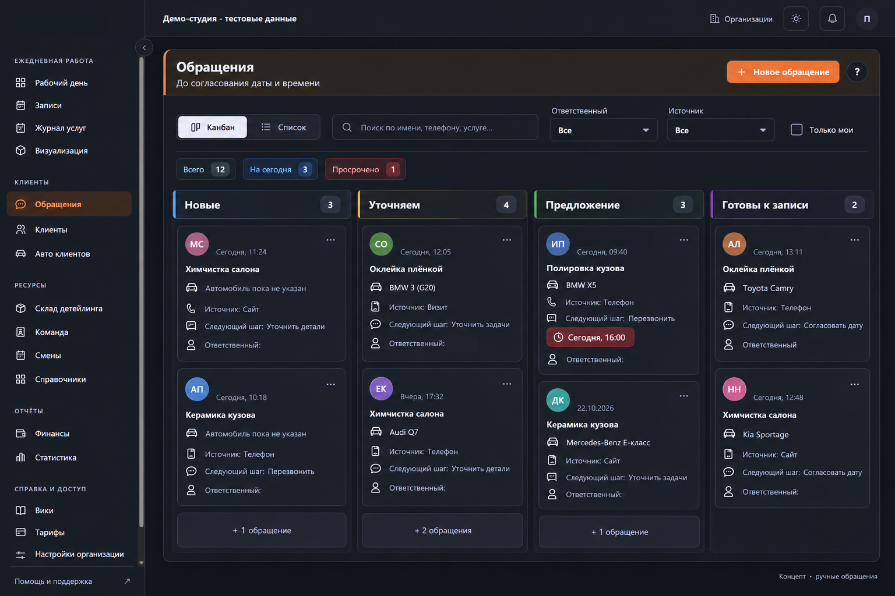
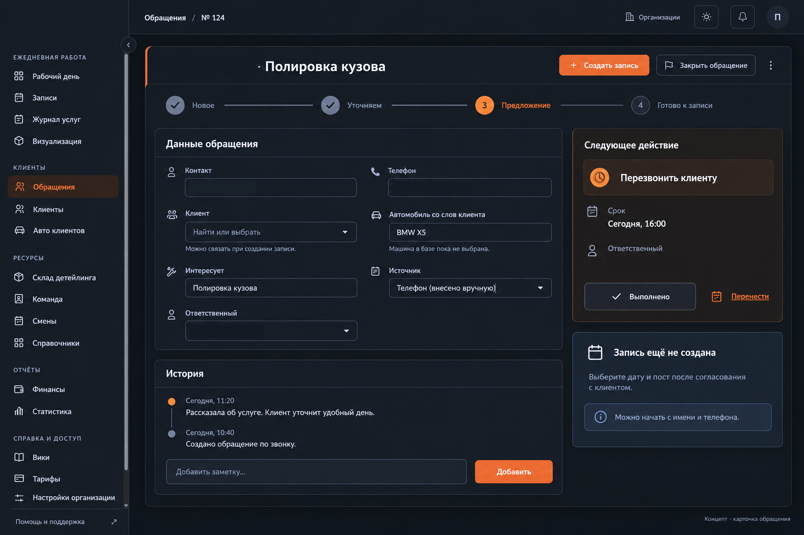
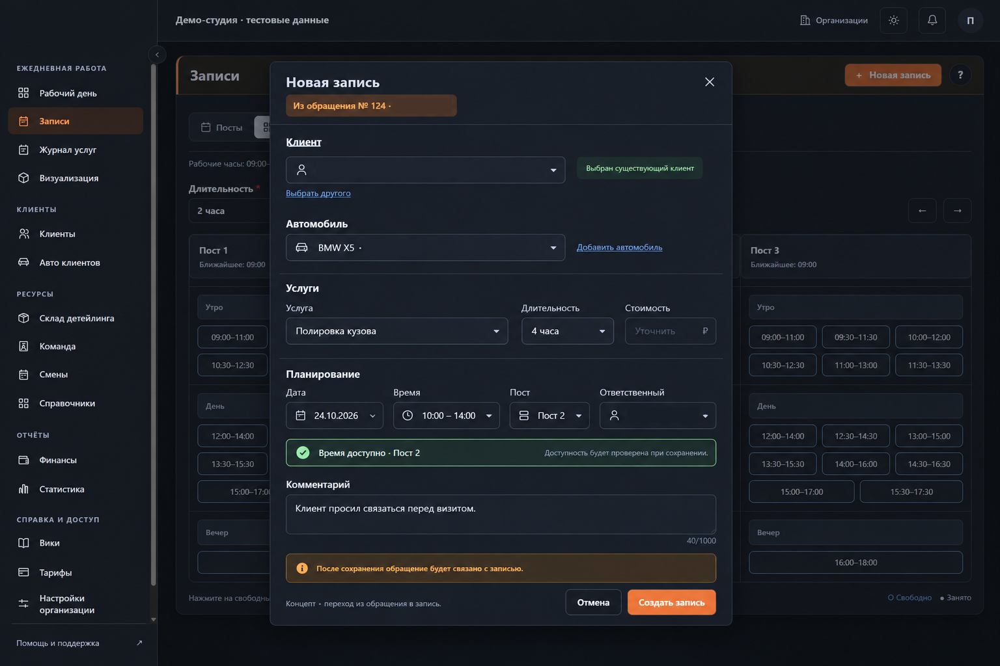
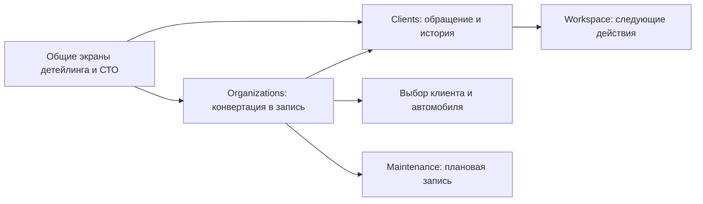

# Ручные обращения до записи: проект второго этапа

[English](inquiries-design.md) | **Русский**

Документ описывает процесс обработки обращений до создания записи. Контракты API, хранение данных и ограничения миграции приведены в [описании реализации](inquiries-implementation.ru.md).

## Пользовательский процесс

Клиент спрашивает о полировке → администратор сохраняет обращение → уточняет объём и договаривается о звонке → выбирает услугу, автомобиль и время → создаёт запись. Обращение может существовать без зарегистрированного клиента и автомобиля. Сохранение обращения и перевод в «Готовы к записи» не занимают пост.

Открытые этапы: «Новое», «Уточняем», «Предложение», «Готовы к записи». Завершение: «Записан» со связью на запись либо «Закрыто» с причиной. Отмена или завершение заказа позднее не должны автоматически переписывать историю обращения.

Можно начать с имени или другого обозначения контакта и описания интереса; известный телефон сохраняется сразу. Для продолжения разговора нужен доступный способ связи, но отсутствие телефона у посетителя не должно мешать ручному обращению. Минимальные обязательные поля уточняются при реализации формы. Ответственный должен быть действующим участником выбранной организации.

> **Концептуальные макеты:** три иллюстрации ниже показывают проектный замысел, а не текущие снимки приложения. Работающая CRM показана в [галерее скриншотов](screenshots.ru.md).

## Три экрана

### Обращения

Новый пункт в существующей группе «Клиенты». Доска и список показывают одни данные; фильтры — ответственный, источник, этап и срок следующего действия. Закрытые и записанные доступны через фильтр. На телефоне основное представление — компактный список. Переход этапа должен работать кнопкой и с клавиатуры; перетаскивание не является условием первого выпуска.

Счётчики и страницы рассчитываются сервером по разрешённым обращениям выбранной организации. Для доски нужны отдельные количества и ограниченные порции карточек по этапам, а не загрузка всей базы в браузер. «Сайт» или «Телефон» на карточке — вручную выбранный источник, а не подключённый канал.

### Карточка

Слева — контакт, интерес, источник, выбранные связи и история; справа — одно следующее действие, срок и ответственный. Описание автомобиля со слов клиента отличается от выбранного автомобиля в базе. Заметка о звонке остаётся заметкой: она не означает отправленное сообщение или запись телефонного разговора.

Имя и телефон без связи с карточкой клиента сохраняются в обращении. При создании записи администратор выбирает найденного клиента либо явно создаёт нового через существующую проверку совпадений. Нельзя автоматически считать одинаковый телефон доказательством одной личности или перепривязывать существующее авто при смене клиента.

### Создание записи

Кнопка открывает существующую форму с контекстом обращения. В неё добавляется предварительное заполнение клиента, контакта, выбранного автомобиля, описания интереса и заметки. Интерес в свободном тексте не превращается автоматически в услугу справочника с выдуманной ценой или длительностью: услугу подтверждает администратор. После выбора времени действуют обычные серверные проверки занятости и доступа.

Ответственный обращения не становится автоматически исполнителем работ или получателем уведомлений. Поле ответственного на макете иллюстрирует контекст менеджера; точное размещение в форме уточняется при реализации. Плательщик и владелец автомобиля сохраняют существующие отдельные правила.

Макеты сгенерированы по принятому тёмному интерфейсу OpenCRM; точная сетка и подписи не являются готовым контрактом. Реализация обязана поддерживать светлую тему и мобильную компоновку. Все контакты, автомобили, услуги и сроки демонстрационные. Иллюстрации описывают пользовательский процесс и не задают оформление конкретной установки.

## Владельцы и связи модулей

Сохраняется модульный монолит, общий `OpenCRMContext` и PostgreSQL. Новое самостоятельное приложение или микросервис для обращений не нужны.

| Область | Предлагаемая ответственность |
| --- | --- |
| `OpenCRM.Modules.Clients`, область `Inquiries` | Обращения, этапы, заметки, ответственный, следующее действие и связь с результатом. Контракты — в существующем `OpenCRM.Modules.Clients.Contracts`. |
| `OpenCRM.Modules.Organizations/Bookings` | Координация превращения обращения в запись с использованием действующих сервисов клиентов, автомобиля и заказа. |
| `OpenCRM.Modules.Maintenance` | Сам заказ, строки услуг, статус исполнения и последующие оплаты. Второй тип заказа для CRM не вводится. |
| `OpenCRM.Modules.Workspace` | Пункт меню, разрешённые счётчики и блок следующих действий в рабочем дне. |
| `packages/workspace` | Общие компоненты и API обращений для детейлинга и СТО; сценарные оболочки сохраняют свои особенности формы записи. |

Реализация обращений не должна ссылаться на реализацию другого модуля. Координатор записи использует контракт Clients для блокировки/проверки обращения и сохранения связи внутри общей транзакции. Контракты не возвращают EF-сущности, `DbContext` или `IQueryable`. Вызовы согласуются с существующими границами, описанными в [текущей архитектуре](architecture-current.ru.md).

## Данные

Достаточно двух новых таблиц; названия предварительные.

- `OrganizationInquiries`: идентификатор и организация, контакт и телефон, необязательные FK клиента и автомобиля, описание автомобиля со слов клиента, интересующая работа, код источника, этап, ответственный, текст и срок следующего действия, причина закрытия, необязательный FK созданного обслуживания, версия, время создания и изменения.
- `OrganizationInquiryEvents`: FK обращения, автор, время, тип события и текст заметки либо исторические значения изменения. Создание, смена этапа, ответственного, срока, выполнение действия, закрытие и конвертация оставляют историю.

Изменяемые связи хранятся в колонках с FK, история не заменяет их JSON-полями. Для событий возможен исторический payload по существующим правилам, но для первого объёма простых колонок достаточно. Связи проверяются на принадлежность той же организации; удаление связанной карточки не должно каскадно уничтожать историю обращения.

Нужны индексы по организации/этапу, ответственному/сроку и нормализованному телефону для поиска, а также уникальность непустой ссылки на созданное обслуживание. В первом объёме одно обращение создаёт одну запись. Несколько разных обращений одного человека разрешены: телефон не является уникальным ключом обращения. Параллельное редактирование защищается версией с понятным конфликтом, а не молчаливым затиранием.

## Следующее действие и существующий Planning

Проверка кода показала: `OrganizationSchedulerTask` допускает отсутствие автомобиля и клиента, поддерживает звонок, ответственного и срок напоминания. Но `SchedulerTaskCommandService` требует включённый `SchedulerModule` и право `scheduler.manage` через `SchedulerAccess`. Эти права нельзя автоматически выдавать сотруднику, который работает с обращениями.

Для первого объёма предлагается ровно одно следующее действие как часть обращения: текст, срок, тот же ответственный. Выполнение оставляет событие и очищает текущий срок; затем можно назначить новое действие. Это не отдельная система задач, фоновых напоминаний и рассылок. Не создаётся вторая копия действия в Planning.

Рабочий день получает небольшой блок «Связаться с клиентами» через разрешённую выборку Clients: просроченное и на выбранный день, со ссылкой в обращение. Текущий `OrganizationWorkdayQueryService` читает обслуживания; нельзя искусственно выдавать обращения за обслуживания ради повторного использования этой выборки. Срок хранится как момент времени, ввод и отображение используют часовой пояс организации.

Если понадобится несколько независимых задач на обращение, нужно заново оценить общий механизм Planning и его права; такого расширения в первый выпуск не входит.

## Конвертация без второй записи

Предлагаемый маршрут: `POST /api/v1/organizations/{organizationId}/inquiries/{inquiryId}/booking`. Тело содержит подтверждённые данные записи и версию обращения; обычные CRUD/история/смена этапа работают через API обращений. Названия DTO и точный состав маршрутов уточняются при реализации.

1. Проверить членство, право управления обращением и создания обслуживания, доступность записи и режим чтения подписки.
2. Открыть одну транзакцию через существующий `IApplicationUnitOfWork` и заблокировать строку обращения в этой организации.
3. Если результат уже связан — вернуть тот же идентификатор записи без повторного создания. Проверка повторного результата идёт раньше конфликта устаревшей версии; при этом сохраняются проверки доступа к результату.
4. Проверить версию и открытое состояние, выбранные связи, услугу, время и пост. Использовать существующую защиту от конкурентного занятия поста.
5. Создать/выбрать клиента и автомобиль существующими сервисами, затем создать плановую запись с действующими строками услуг.
6. Сохранить FK результата, завершающий этап и событие, закрыть следующее действие. Явно вызвать `SaveChanges` перед коммитом: `ApplicationUnitOfWork` сам этого не делает.

Ошибка на любом шаге откатывает весь результат. Повтор после потерянного ответа и два одновременных нажатия возвращают одну запись. Отключение кнопки в браузере лишь улучшает интерфейс; защиту обеспечивает сервер. Существующие quick-endpoint не дают такой гарантии для обращения, поэтому отправка предзаполненной формы идёт через маршрут конвертации. Обычная запись без обращения сохраняет свой текущий маршрут.

Режим «Простой / По этапам» должен быть общим для детейлинга и СТО. Ограничение только СТО не является согласованным продуктовым требованием. Простой режим убирает промежуточные этапы: для оформления выполненной работы достаточно внести автомобиль, услуги и сумму и сохранить результат. Режим «По этапам» позволяет вести работу по статусам. Отдельное намерение «записать на будущий визит» должно резервировать время и не означать выполненную работу даже в простом режиме; внутренний плановый статус не требует показывать всю цепочку этапов. Нельзя автоматически считать каждую новую запись выполненной только из-за простого режима. Ниже описано обнаруженное текущее расхождение, а не желаемое различие направлений. Общий режим реализован отдельным локальным пакетом; [реализация и проверки](simple-maintenance-workflow.ru.md). Реализация обращений и её проверки описаны в отдельном протоколе выше.

Будущая запись в простом режиме: единый сценарий для детейлинга и СТО — «Запланировано → Выдать → Выдано». Создание будущего визита сохраняет плановую запись и резервирует пост; в карточке не требуется проходить «В работе», «Проверка» и «Готов к выдаче». Основное действие — «Выдать». Оно одной серверной операцией завершает работу и фиксирует фактическую выдачу через существующие поля обслуживания, без фиктивных отчётов о прохождении промежуточных этапов. Наступление даты визита само по себе не завершает работу и не фиксирует выдачу. Выдача не означает оплату: действующие права и правила расчётов проверяются отдельно. Перенос и отмена записи сохраняются. Для режима «По этапам» остаётся последовательное ведение работ. Этот общий рабочий процесс реализован локально отдельным пакетом до обращений.

Обнаруженное расхождение исправлено: быстрые сервисы обоих направлений принимают явное намерение `IsPlannedBooking` с безопасным значением `true` по умолчанию. При конвертации обращения требуется передавать плановое намерение; пользовательский переход «Выдать» затем выполняется общей командой простого режима. Исправлять статус постфактум не требуется. Явное `false` используется для оформления уже выполненной работы в простом режиме. В детейлинге форма записи требует госномер; обращение до перехода в запись его не требует.

## Доступ и границы выпуска

Предложение: отдельные права чтения и управления обращениями; право создавать обслуживание проверяется дополнительно при конвертации. Ответственный — действующий участник организации, но назначение ответственным само по себе не выдаёт права. «Только мои» — фильтр интерфейса, не замена серверной авторизации. Детализация доступа к чужим обращениям должна следовать принятой модели прав; сервер фильтрует данные, историю и счётчики одинаково.

Общий процесс применяется к детейлингу и СТО. Новые страницы не включаются для скрытого автопарка. Источник вводится вручную. Переписка, телефония, формы сайта, ИИ, эквайринг, автоматические сообщения, несколько воронок, конструктор автоматизаций и отдельный глобальный раздел задач в этот объём не входят.

## Проверка при реализации

Проверить обращение без авто/клиента, ручной выбор существующего клиента, разные обращения с одним телефоном, закрытие с причиной, срок и смену ответственного, конфликт версий, изоляцию организаций и режим чтения. Для конвертации обязательны проверки двух одновременных запросов, повтора после потери ответа, ошибки/отката между созданием заказа и связью, занятого поста и планового статуса в обоих режимах детейлинга и СТО. Для простого режима дополнительно проверить выдачу плановой записи одним действием без промежуточных этапов, отсутствие автоматической выдачи при наступлении даты и независимость статуса оплаты. Миграции проверяются по соседним EF-миграциям, атрибутам, designer и snapshot согласно AGENTS; в исходном предложении миграций не было.

## Проверенные точки текущего кода

- `src/OpenCRM.Modules.Clients` и `src/OpenCRM.Modules.Clients.Contracts` — существующий владелец карточек клиентов.
- `src/OpenCRM.Domain/OrganizationSchedulerTask.cs`, `src/OpenCRM.Modules.Planning/SchedulerAccess.cs`, `SchedulerTaskCommandService.cs` — возможности задач и ограничения прав.
- `src/OpenCRM.Modules.Organizations/Bookings/OrganizationDetailingQuickBookingService.cs`, `OrganizationAutoServiceQuickBookingService.cs`, `QuickBookingSupport.cs` — создание записи и разрешение клиента.
- `src/OpenCRM.WebApp/Controllers/Api/V1/Organizations/OrganizationDetailingQuickBookingsApiController.cs` — существующая транзакционная оболочка быстрой записи.
- `src/OpenCRM.Infrastructure.Common/ApplicationUnitOfWork.cs` — транзакция без автоматического `SaveChanges`.
- `src/OpenCRM.Modules.Workspace/Workday/OrganizationWorkdayQueryService.cs` — текущая выборка рабочего дня.
- `src/OpenCRM.Frontend/Scenarios/detailing-client/src/components/QuickBookingSection.vue` и аналог СТО — существующие формы и частичная поддержка начальных данных. Предзаполнение клиента и контекста обращения ещё нужно добавить.
