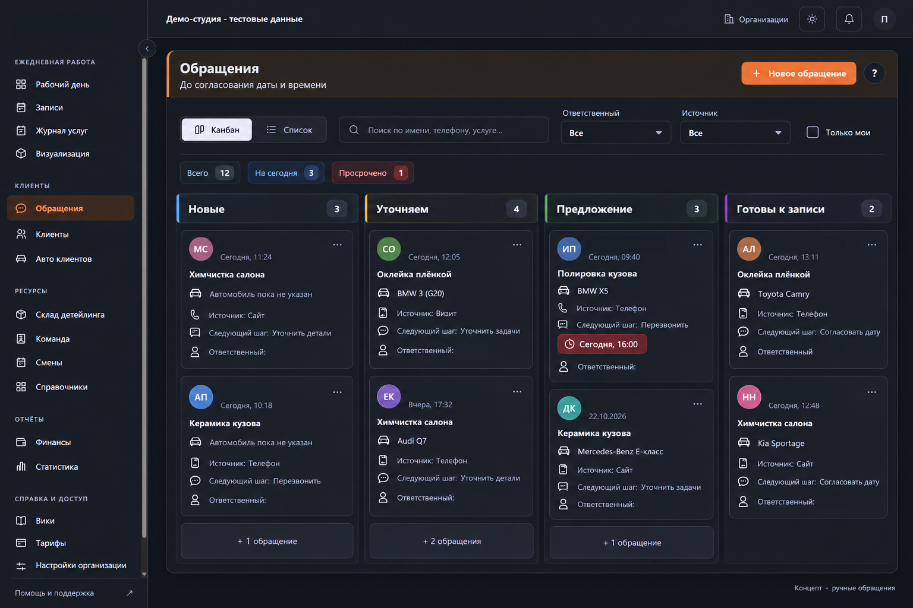
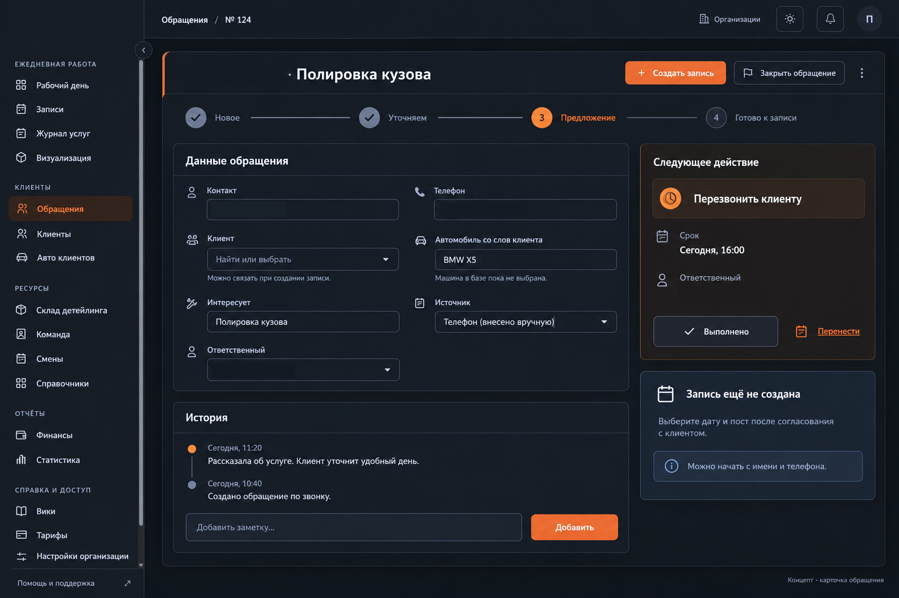
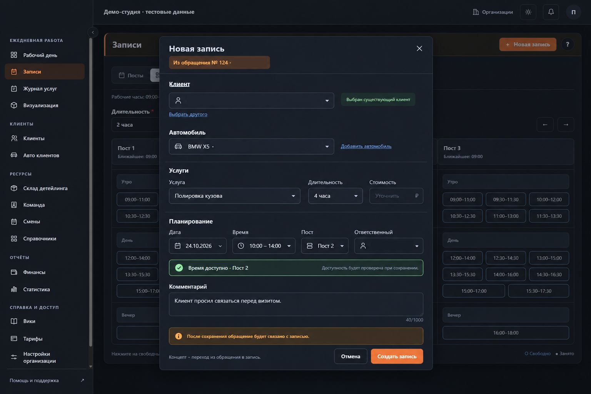
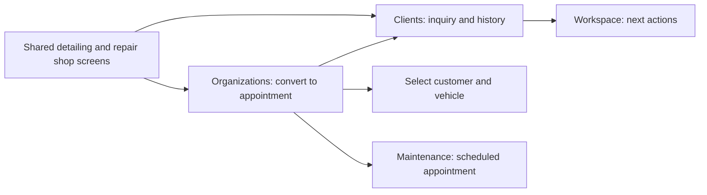

# 咨询设计

[English](inquiries-design.md) | [Русский](inquiries-design.ru.md) | **简体中文**

> 本页为机器译稿。涉及部署、接口或数据变更时，请同时核对英文或俄文原文。

 本设计中的订阅和只读限制适用于下列时间: `PlatformPolicy:Commercial:Enabled=true`. 默认的基准模式不需要付费计划;会员资格和行动许可仍然是强制性的.

 本文件介绍在任命之前处理询问的情况。 API合同、数据存储和迁移方面的制约因素存在于 [执行文件](inquiries-implementation.zh-CN.md).

## 用户工作流程

顾客询问打磨情况 —— 管理员记录询问 —— 澄清范围并安排电话 —— 选择服务、车辆和时间 —— 确定预约。 调查可以在没有注册客户或车辆的情况下进行。 保存查询或将其移至“准备预订”并不保留一个工位。

开放阶段:“新”、“澄清”、“提议”和“准备订票”。 终端结果:“已订出”,与任命有关,或“已订出”,有正当理由。 以后取消或完成工作命令不得重写查询历史.

用户可以从名称或另一个联系标签开始,并描述客户的兴趣;一个已知的电话号码立即被保存. 继续交谈需要一种可用的联系方法,但是没有电话号码的访客仍必须能够进行人工查询. 所需表格字段将在执行期间最后确定。 受让人必须是所选组织的积极成员。

> **设计概念:**  下面的三个插图是模型,而不是当前应用程序抓取.  见 [截图画廊](screenshots.zh-CN.md) 用于运行的CRM.

## 3个屏幕

### 问询

现有“客户”组中的一个新项目。 棋盘和列表显示相同数据;过滤器包括受让人、来源、舞台和下个行动到期日。 已关闭和预定的物品可通过过滤器取出。  在电话上,主要视图是紧凑的列表. 阶段更改必须按下按钮和键盘进行;第一次发布不需要拖放.

服务器从查询中计算出当前用户在所选组织中可能访问的计数和页面. 棋盘每阶段需要单独的计数和分批的卡片,而不是将整个数据库装入浏览器。卡片上的“Website”或“Phone”是一个手动选择的来源,而不是一个连接的通道。

### 简介

左侧包含联系人,兴趣,来源,所选关系,以及历史;右侧包含下一个动作,它的到期日,以及受让人. 客户提供的车辆说明不同于数据库中选定的车辆。 电话便条只是个便条;这并不意味着发送了信息或记录了电话。

调查中储存了没有客户特征链接的姓名和电话号码。  当创建指定时,管理员会明确选择匹配的客户,或者使用现有的重复检查来明确创建新的客户. 该系统不得将匹配的电话号码作为身份证明,也不得在客户改变时将现有车辆重新连接。

### 创建预约

按钮打开带有询问上下文的现有窗体。 表格预先填入客户、联系人、选定的车辆、利息说明和附注。 自由文本利息不会自动转换为带有被发明出的价格或期限的目录服务;管理员确认该服务. 现有服务器侧可用性和访问检查在选择一段时间后适用。

查询受让人不会自动成为工人或通知接收人。 模拟模型中的受让人字段说明了管理者的背景;其形式的确切位置由执行期间决定。 付款人和车辆所有人的行为保持他们现有的单独规则。

模型是使用公认的暗的OpenCRM接口生成的;其准确的网格和标签不是生产合同. 实施必须支持轻主题和移动布局.  所有联系人、车辆、服务和日期均为示范数据。 插图描述了用户的工作流程,没有规定特定安装的品牌.

## 模块所有权和关系

保留模块化的单片, 共享 `OpenCRMContext`,还有PostgreSQL. 询问不需要新的独立应用程序或微服务.

| 区域 |  拟议的责任 |
| --- | --- |
| `OpenCRM.Modules.Clients`, `Inquiries` 区域 | 询问、阶段、笔记、受让人、下一步行动以及与结果的联系。 合同在现有的 `OpenCRM.Modules.Clients.Contracts`. |
| `OpenCRM.Modules.Organizations/Bookings` | 利用现有客户、车辆和工作订单服务,协调查询转换。 |
| `OpenCRM.Modules.Maintenance` | 拥有工作订单,服务行,执行状况,以及后来的付款.  不要引入第二个 CRM 命令类型 。 |
| `OpenCRM.Modules.Workspace` | 菜单项,权限过滤计数,以及工作日的下个动作块. |
| `packages/workspace` | 共享查询组件和API,用于详细介绍和汽车服务;情景壳保留其任用形式差异。 |

调查的执行不得取决于另一个单元的执行。 预订协调员利用客户合同锁定/检查询问,并保存其在共享交易中的关系. 合同不归还EF实体, `DbContext`,或 `IQueryable`. 呼声必须沿着《宪章》所述的现有边界线进行。 [ 当前架构](architecture-current.zh-CN.md).

## 数据

 两个新的表格应该足够;姓名是临时的。

- `OrganizationInquiries`:标识与组织,联系与电话,可选客户和车辆的外国密钥,客户提供的车辆描述,所请求的工作,源代码,舞台,受让人,下个动作文本和到期日,关闭原因,可选创建维护的外国密钥,版本,创建和更新时间戳.
- `OrganizationInquiryEvents`: 询问外国密钥,作者,时间戳,事件类型,以及更改的注释文本或历史值. 设定、阶段和受让人变更、到期日变更、动作完成、关闭和转换均记录在案。

变异关系属于外键列;历史不以JSON字段来取而代之. 事件有效载荷可能遵循现行的历史载荷惯例,但简单的列就足以满足第一个范围。 关系必须检查同一组织的所有权;删除链接的简介不得连带删除查询历史。

增加组织/阶段、受让人/到期日的索引,以及正常的电话搜索,使创建的维护的非空链接具有独有性。 最初一项调查产生一项任命。 允许对一人进行多次查询:电话号码并不是唯一的查询密钥.  同时期编辑使用一个版本和一个明显的冲突,而不是默默地互相覆盖.

## 下一步行动和现有的规划单元

密码检查显示 `OrganizationSchedulerTask` 允许丢失的车辆和客户,并支持一个呼叫、受让人和提醒截止日期。  不过, `SchedulerTaskCommandService` 要求 `SchedulerModule` 启用和 `scheduler.manage` 允许通过 `SchedulerAccess`. 不得自动给予从事调查工作的雇员这些许可。

 对于第一次发布,调查有确切的下一个行动:案文、到期日以及同一个受让人。 完成它会留下一个历史事件,并清除当前到期日;然后可以设定新的动作.  这不是一个单独的任务、背景提醒或信息系统。  在规划中不产生重复行动。

工作日从授权客户查询中获取一个小型的“接触客户”面板:逾期的行动和所选日期到期的行动,并与调查链接。  目前情况 `OrganizationWorkdayQueryService` 阅读维护记录; 不得为了重新使用该查询而伪装为维护。  应交日期作为即时存储,输入和显示在该组织的时区.

 如果每次调查都需要多个独立的任务,则必须重新评价共同规划机制及其权限;这种扩展不在第一次发布之前。

## 改划,不重复任用

 拟议路线: `POST /api/v1/organizations/{organizationId}/inquiries/{inquiryId}/booking`. 该机构包含确认的任命细节和询问版本;普通的CRUD,历史,和舞台变化使用询问API. DTO名称和准确的路线集将在实施期间最后确定.

1. 检查成员,允许管理询问并创建维护,预约可用,以及订阅只读模式.
2.  通过已有的交易开始一项交易 `IApplicationUnitOfWork` 并且把组织里的调查排锁起来
3.  如果结果已经链接, 请返回同一预约ID而不创建另一个。 NAME OF TRATORS  在检查 stale 版本前先检查现有结果,同时保留对结果的访问检查.
4.  请检查date=中的日期值 (帮助) 版本和开放状态,选择的关系,服务,时间,和工位. 使用现有的保护,防止同时进行工位预订。
5.  通过现有服务创建或选择客户和车辆,然后与现有服务行创建计划预约.
6. 保存结果的外国密钥,终端阶段和事件,并清除下个动作. 明确呼吁 `SaveChanges` 犯前行为: `ApplicationUnitOfWork`  不这样做本身。

任何步骤的错误都会使整个结果倒退.  在回复失败后重试, 两次同时点击返回一次预约 。 禁用浏览器按钮只会改进界面;服务器提供保护. 现有的速订终点不能为查询提供这种保证,所以通过转换路径提交预填表. 未经调查的任用保持目前的路线。

“简单/分阶段”模式必须通过详细介绍和汽车服务共享。 将其限于汽车服务并不是一项商定的产品要求。 简单模式可以去掉中间阶段:要记录已完成的工作,只需输入车辆,服务,数量和保存即可. “分期”模式支持按状态跟踪工作. 单独的“未来访问手册”意图必须保留时间,不得意味着完成的工作,即使是以简单的方式完成;内部计划状态并不要求显示整个阶段的顺序。  不能仅仅因为启用了简单的模式,就自动将新的任命视为已完成。 此处所述的区别是目前观察到的差别,而不是设想方案之间的预期差别。 共享模式已在一个单独的本地软件包中执行;参见 [简单的维护工作流程](simple-maintenance-workflow.zh-CN.md). 以上分别说明调查执行情况和检查情况.

今后以简单方式进行的任命使用一个工作流程来详细介绍和提供汽车服务:“计划——移交——移交”。 未来访问保留了计划的任命,并预留了一个工位;卡片不需要“正在进行中”、“审查”或“准备移交”。 并且没有中间阶段的假报告 达到任命日期本身并不能完成工作或记录移交情况。 交接并不意味着支付;现有的权限和计算规则分别检查. 仍可采用重新安排时间和取消时间的办法,“分阶段”模式继续按顺序跟踪工作情况。  这一共享工作流程在询问前以单独的一揽子办法在当地实施。

已查明的出入得到纠正:两种情况下的快速订帐服务都接受明确无误的 `IsPlannedBooking` 意图, 默认安全到 `true`. 调查转换必须发送计划意图;用户的"抓好"过渡然后使用共享的简单模式命令. 无需修复危险后状态。 明确 `false` 用于以简单模式记录已完成的工作。 详细预约表需要登记号码;在转换前不需要登记号码。

## 访问和释放边界

提议:单独查看和管理询问的权限;在转换过程中额外检查创建维护的许可. 受让人必须是活跃组织的成员,但单是转让不能给予任何权限。 “只允许”是一个接口过滤器,而不是服务器授权的替代物。 获取别人的询问必须遵循被接受的许可模式;服务器过滤数据、历史和计数一致。

共享的工作流程适用于详细化和汽车服务. 隐藏机队情景的新页面没有启用 。 源是手动输入的 。 通讯、电话、网站表格、AI、获取、自动化信息、多管线、一个自动化建设器和一个单独的全球任务部分都不属于这一范围。

## 执行情况核查

 在没有车辆/客户的情况下检查询问,手工选择现有客户,不同的询问共享电话号码,关闭有原因,到期日和受让人更改,版本冲突,组织隔离,以及只读模式. 转换必须同时测试两个请求,在丢失的响应后重试,工作订单创建和连接之间的故障/回滚,一个被占用的工位,以及详细和汽车服务模式中的计划状态.  在简单模式下,还核查一项计划任用的一次行动交接没有中间阶段,当日期到来时没有自动交接,以及付款状况独立。  根据 AGENTS 对照相邻的 EF 迁移,属性,设计者,和快照来检查迁移情况;最初的建议没有迁移.

## 验证当前代码中的点数

- `src/OpenCRM.Modules.Clients` 和 `src/OpenCRM.Modules.Clients.Contracts` ——现有客户简介所有者.
- `src/OpenCRM.Domain/OrganizationSchedulerTask.cs`, `src/OpenCRM.Modules.Planning/SchedulerAccess.cs`, `SchedulerTaskCommandService.cs` ——任务能力和准入限制.
- `src/OpenCRM.Modules.Organizations/Bookings/OrganizationDetailingQuickBookingService.cs`, `OrganizationAutoServiceQuickBookingService.cs`, `QuickBookingSupport.cs` 设立任命和解决客户问题。
- `src/OpenCRM.WebApp/Controllers/Api/V1/Organizations/OrganizationDetailingQuickBookingsApiController.cs` ——现有交易包装以快速预订.
- `src/OpenCRM.Infrastructure.Common/ApplicationUnitOfWork.cs` - 交易不调用 `SaveChanges` 自动。
