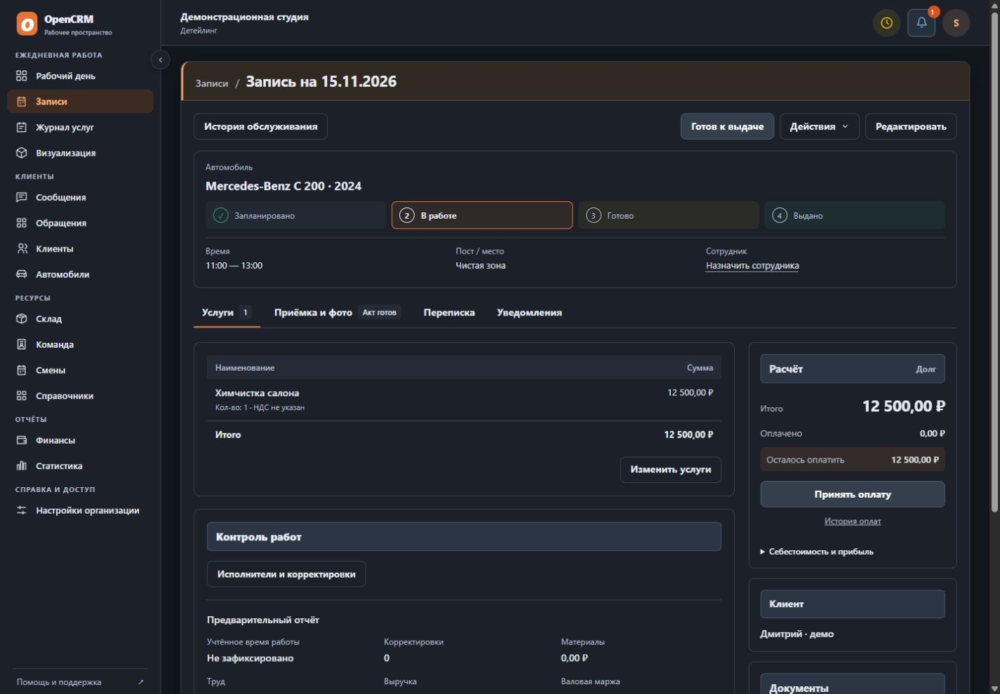

# OpenCRM screenshot gallery

**English** | [Русский](screenshots.ru.md)

These are real captures of a local OpenCRM installation, not generated interface mockups. All customer names, vehicles, amounts, and records are demonstration data. Commercial mode is disabled. Dark and light themes use the same CRM functionality.

The UI is shown in Russian. English captions explain each view; changing the documentation language does not change the application language. Click an image to open it at its original resolution.

[Workday](#workday) · [Customers](#customers) · [Appointments](#appointments) · [Orders](#orders) · [Intake](#intake) · [Inquiries](#inquiries) · [Statistics](#statistics) · [Permissions](#permissions) · [Public pages](#public-pages)

## Workday

Four stages keep appointments, active work, ready vehicles, and handovers together. The organization is configured with three work areas and example orders.

The same workday in light theme

## Customers

A populated customer list with search, filters, vehicle counts, and visit history. Customer names are explicitly marked as demonstration entries.

## Appointments

The work-bay schedule places appointments on a time grid. The example shows planned, in-progress, ready, and handed-over orders across three configured areas. This is a viewport capture; the schedule continues below the visible hours.

## Orders

The work order brings together the vehicle, workflow stage, services, customer, and payment summary. Lower sections continue below this viewport.

## Intake

The intake tab records condition and damage on four vehicle projections. The page is scrolled to the damage diagram and documents. The vehicle drawing is a shared schematic rather than a model-specific photograph; no customer photos are included in this example.

## Inquiries

The board follows an inquiry through New, Clarifying, Proposal, and Ready to book. These stages do not themselves reserve an appointment.

An inquiry record combines the customer's request, next action, and event history. The example email uses the reserved `example.invalid` domain and is not a real contact.

## Statistics

Operational CRM metrics summarize completed work, amounts, customers, vehicles, and current statuses. These are organization work statistics, not website visitor analytics.

## Permissions

Built-in roles have separate permission sets. The example selects Employee and filters the permission list by customers; no permissions were changed for the screenshot.

## Public pages

The neutral black-and-white home page is a starting point for an installation owner's own branding and public content.

Password sign-in is available without a mandatory email delivery service in the base configuration. The form is intentionally empty in this capture.

## About these images

The captures retain the actual application interface. No AI generation, interface repainting, invented controls, or real customer information was used. Example database setup and access credentials are kept outside the repository. Older design concepts in [inquiry design](inquiries-design.md) illustrate design intent and are not screenshots of the running application.

[Project overview](../README.md) · [Documentation](README.md) · [Local setup](local-run.md)
