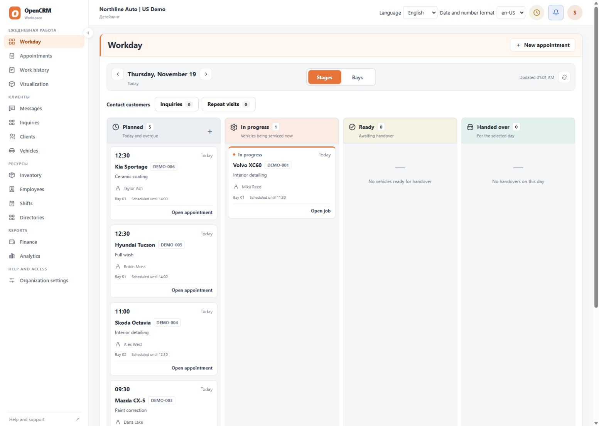
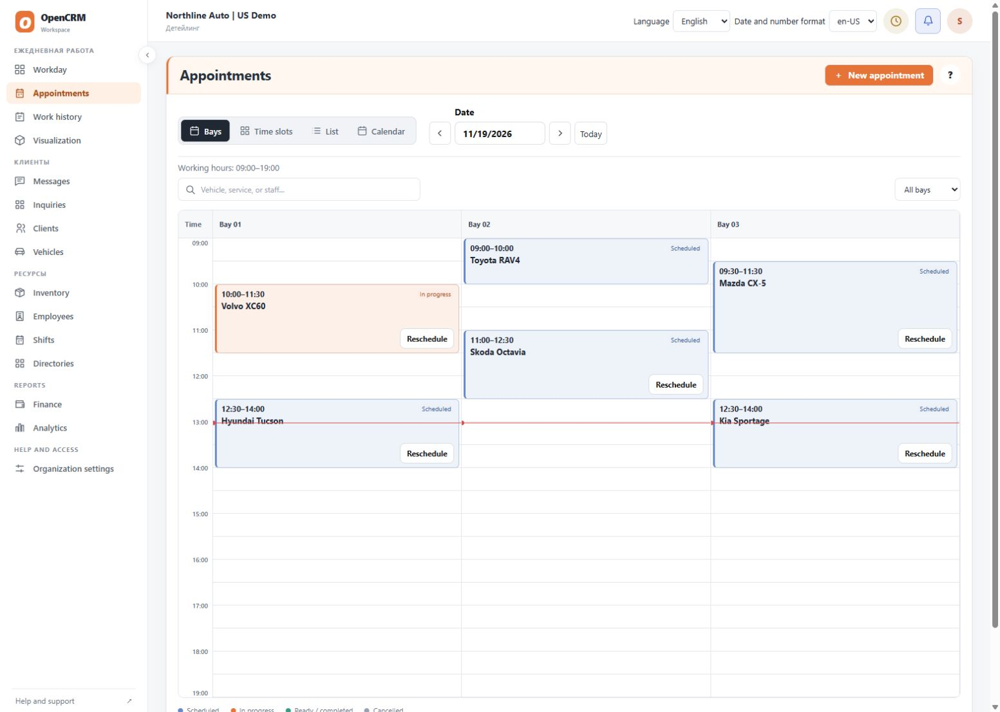
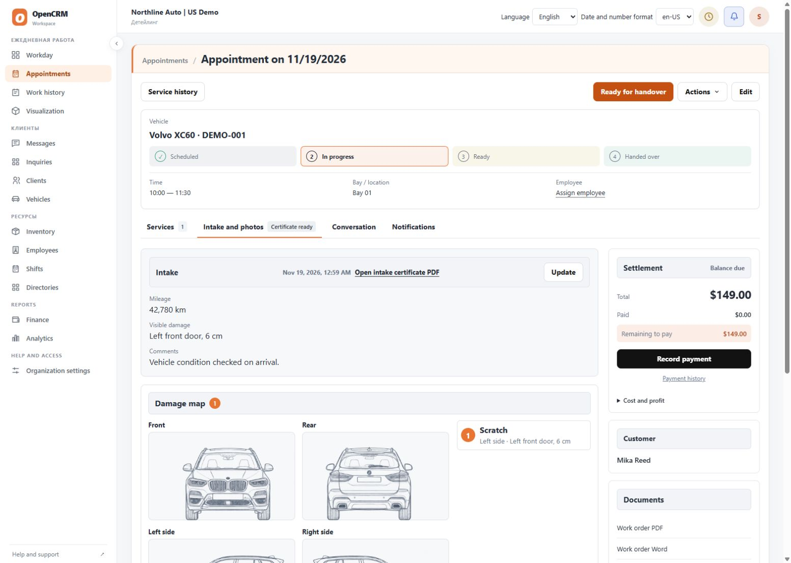
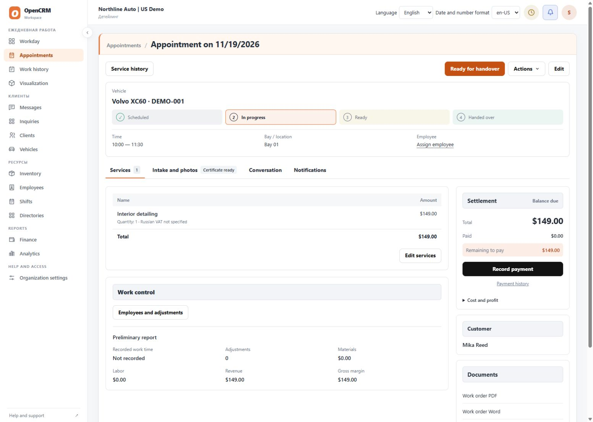

# OpenCRM screenshot gallery

**English** | [Русский](screenshots.ru.md) | [简体中文](screenshots.zh-CN.md)

Screenshots from a local OpenCRM installation using the English interface and a fictitious workshop with USD accounting. Plates use the `DEMO-` format. Phone numbers and VINs are blank.

## Workday

See scheduled jobs and work in progress on a single board.

## Work-bay schedule

Six appointments are shown across three work bays.

## Vehicle intake and damage map

The Volvo XC60 demo record has a scratch marked on its left side.

## Work order

The order shows the services, current stage, and the amount due in USD.

[Project overview](../README.md) · [Documentation](README.md) · [Local setup](local-run.md)
