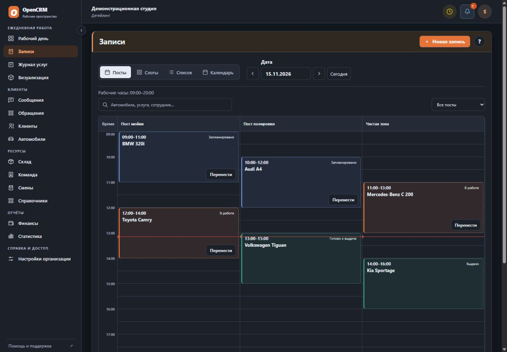
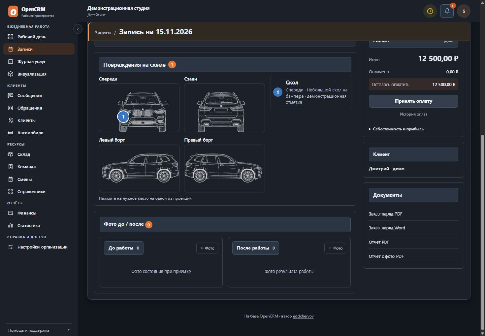
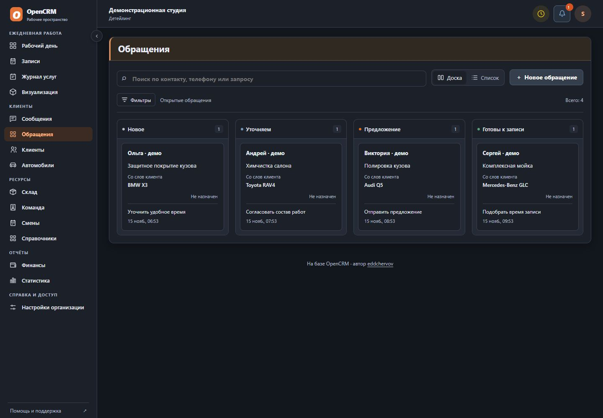
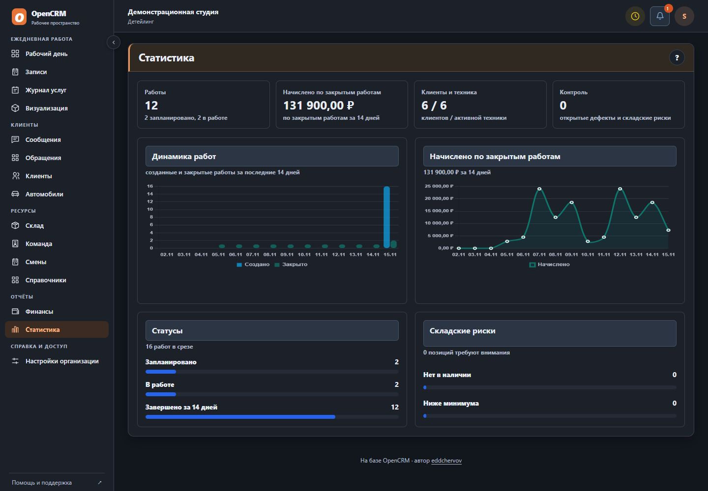
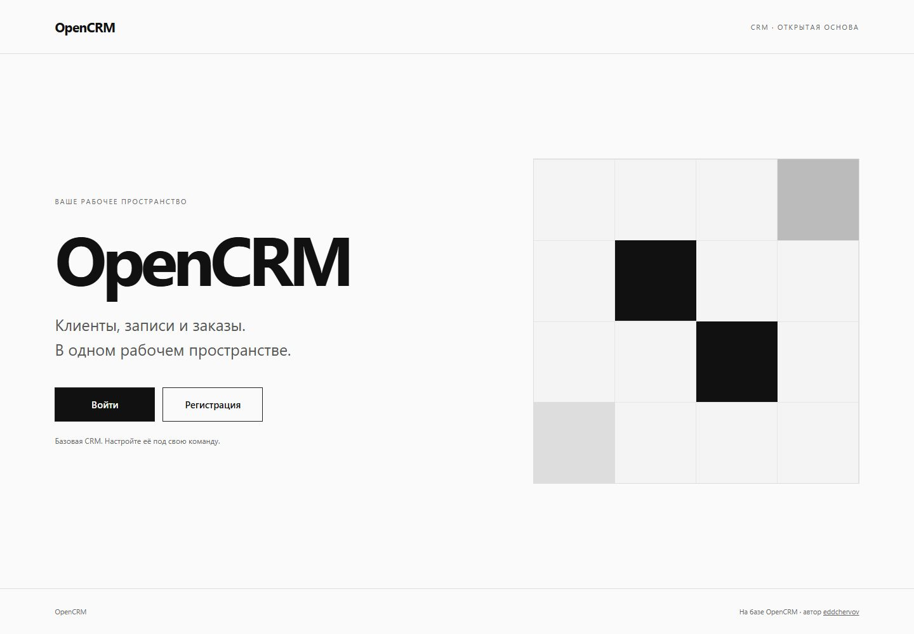

# Галерея интерфейса OpenCRM

[English](screenshots.md) | **Русский**

Здесь настоящие снимки локальной OpenCRM, а не сгенерированные макеты интерфейса. Имена клиентов, автомобили, суммы и записи — демонстрационные данные. Коммерческий режим выключен. Светлая и тёмная темы используют одинаковый функционал CRM.

Интерфейс показан на русском языке. Обе версии документации используют одни изображения; переключение языка документации не меняет язык приложения. Нажмите на изображение, чтобы открыть его в исходном разрешении.

[Рабочий день](#рабочий-день) · [Клиенты](#клиенты) · [Записи](#записи) · [Заказы](#заказы) · [Приёмка](#приёмка) · [Обращения](#обращения) · [Статистика](#статистика) · [Права](#права) · [Публичные страницы](#публичные-страницы)

## Рабочий день

Четыре этапа объединяют записи, текущую работу, готовые автомобили и выдачу. В организации настроены три рабочие зоны и созданы демонстрационные заказы.

Тот же рабочий день в светлой теме

## Клиенты

Наполненный список клиентов с поиском, фильтрами, количеством автомобилей и историей визитов. Имена клиентов явно помечены как демонстрационные.

## Записи

Расписание располагает записи на временной сетке по постам. В примере показаны плановые, текущие, готовые и выданные заказы в трёх настроенных зонах. Это снимок видимой области; ниже показанных часов расписание продолжается.

## Заказы

Карточка объединяет автомобиль, этап работы, услуги, клиента и расчёты. Нижние разделы продолжаются за границей видимой области.

## Приёмка

Вкладка приёмки фиксирует состояние и повреждения на четырёх проекциях автомобиля. Страница прокручена к схеме повреждений и документам. Рисунок автомобиля — общая условная схема, а не фотография конкретной модели; клиентских фотографий в этом примере нет.

## Обращения

Доска ведёт обращение через этапы «Новое», «Уточняем», «Предложение» и «Готовы к записи». Сами по себе эти этапы не резервируют время записи.

Карточка объединяет запрос клиента, следующее действие и историю событий. Email в примере использует зарезервированный домен `example.invalid` и не является реальным контактом.

## Статистика

Рабочие показатели CRM отражают выполненные работы, суммы, клиентов, автомобили и текущие статусы. Это статистика работы организации, а не аналитика посещений сайта.

## Права

Встроенные роли имеют отдельные наборы разрешений. В примере выбрана роль «Сотрудник» и включён поиск прав по клиентам; для снимка разрешения не изменялись.

## Публичные страницы

Нейтральная чёрно-белая главная — отправная точка для собственного бренда и публичного содержания установки.

В базовой конфигурации парольный вход доступен без обязательного сервиса доставки писем. На снимке форма намеренно не заполнена.

## Об изображениях

Снимки сохраняют настоящий интерфейс приложения. Генерация нейросетью, перерисовка интерфейса, выдуманные элементы и сведения реальных клиентов не использовались. Подготовка демонстрационной базы и данные доступа хранятся вне репозитория. Старые концепты в [дизайне обращений](inquiries-design.ru.md) показывают проектный замысел и не являются снимками работающего приложения.

[Обзор проекта](../README.ru.md) · [Документация](README.ru.md) · [Локальный запуск](local-run.ru.md)
