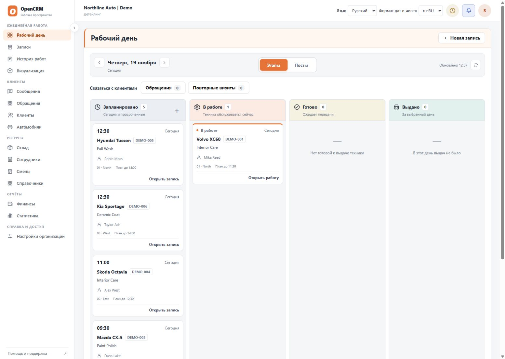
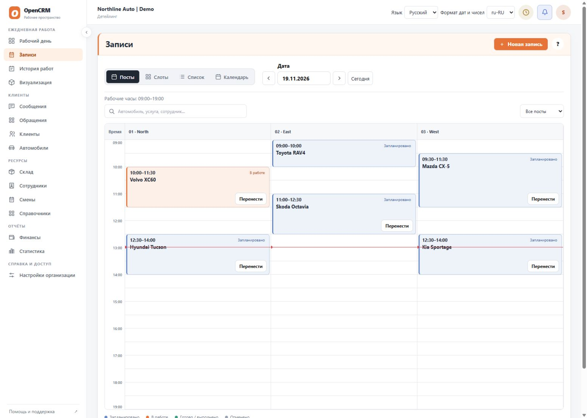
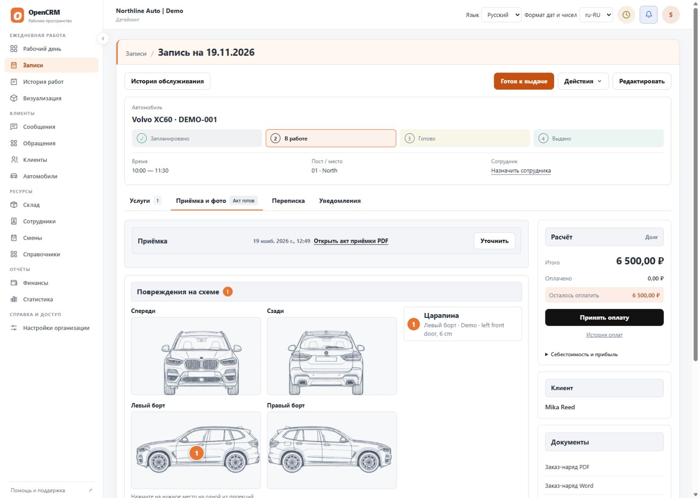
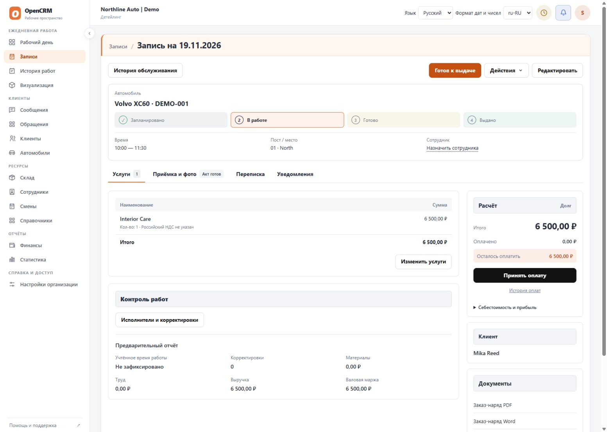

# Галерея интерфейса OpenCRM

[English](screenshots.md) | **Русский** | [简体中文](screenshots.zh-CN.md)

Снимки локальной установки OpenCRM с русским интерфейсом и вымышленной мастерской с учётом в рублях. Номера машин начинаются с `DEMO-`. Телефоны и VIN оставлены пустыми.

## Рабочий день

На одной доске видны запланированные записи и машины в работе.

## Расписание по постам

Шесть демонстрационных записей распределены по трём постам.

## Приёмка и схема повреждений

В карточке Volvo XC60 на левом борту отмечена царапина.

## Заказ-наряд

В заказе видны услуги, этап работы и сумма в рублях.

[Обзор проекта](../README.ru.md) · [Документация](README.ru.md) · [Локальный запуск](local-run.ru.md)
