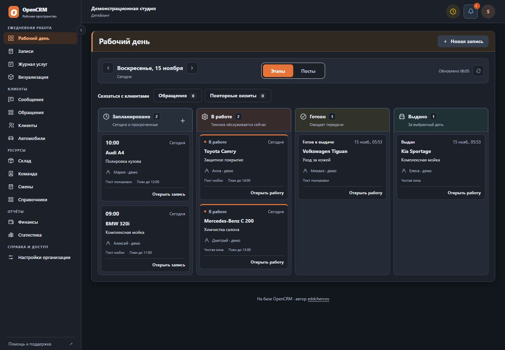
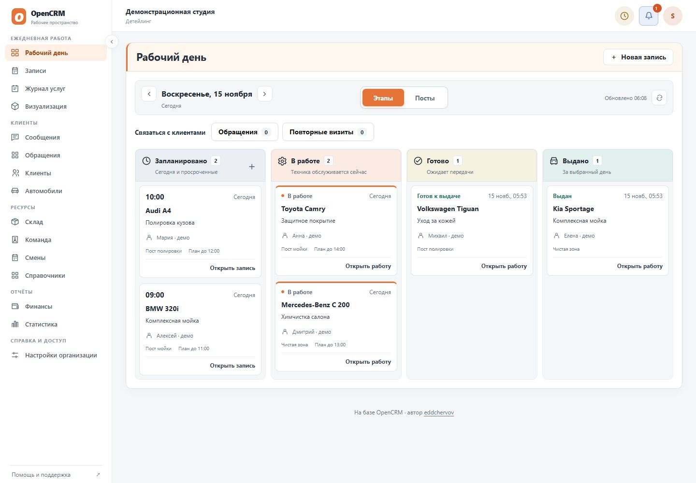
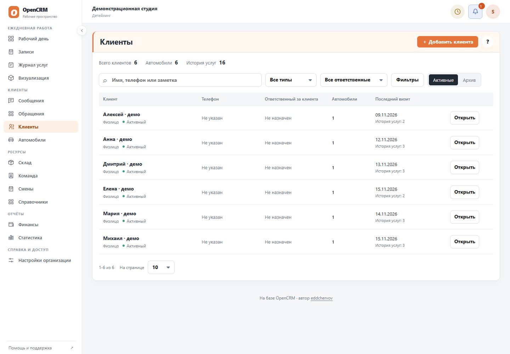
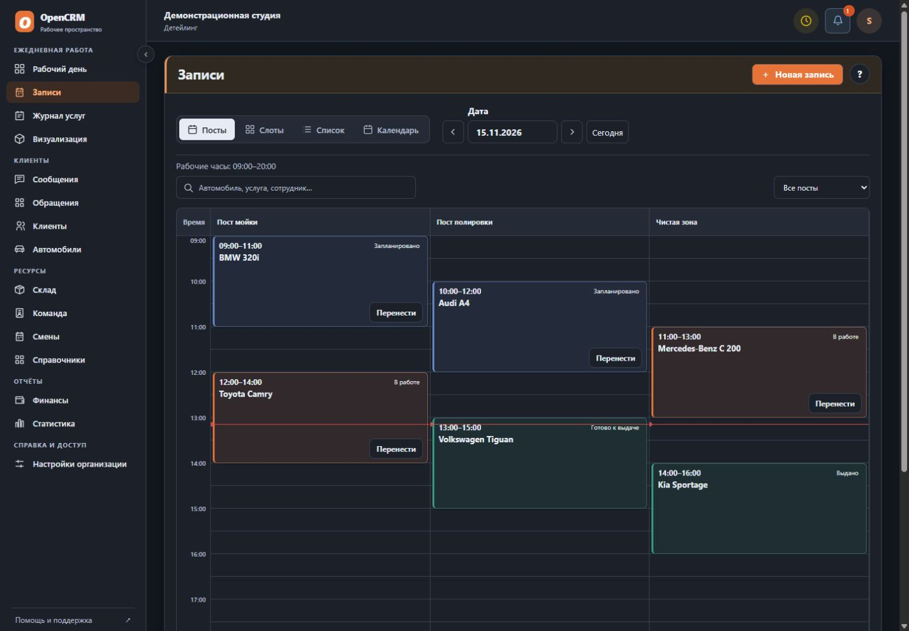
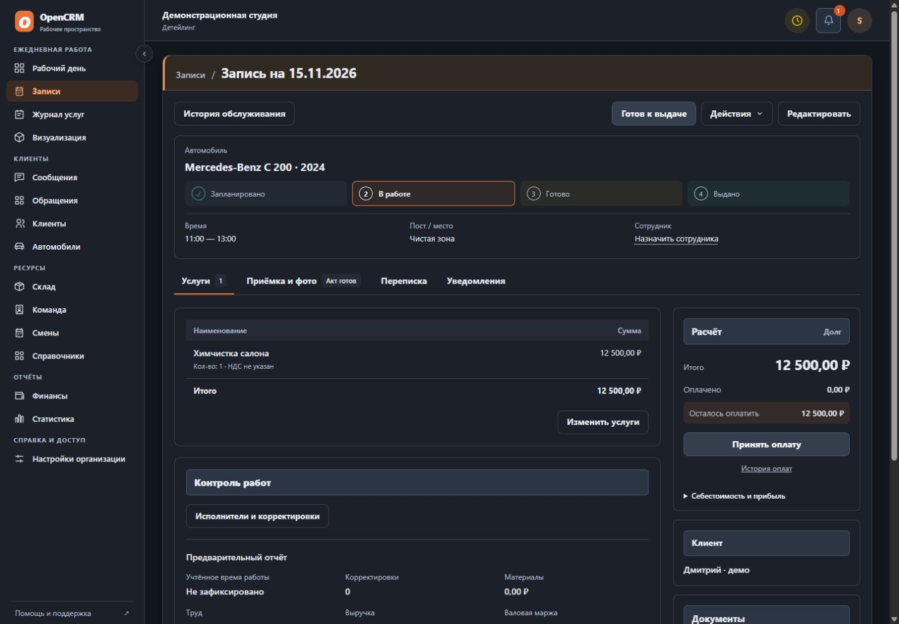
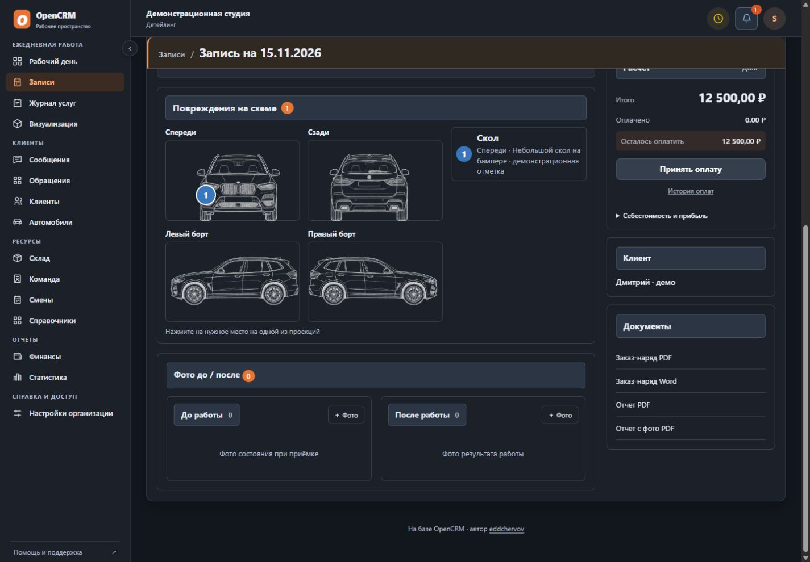
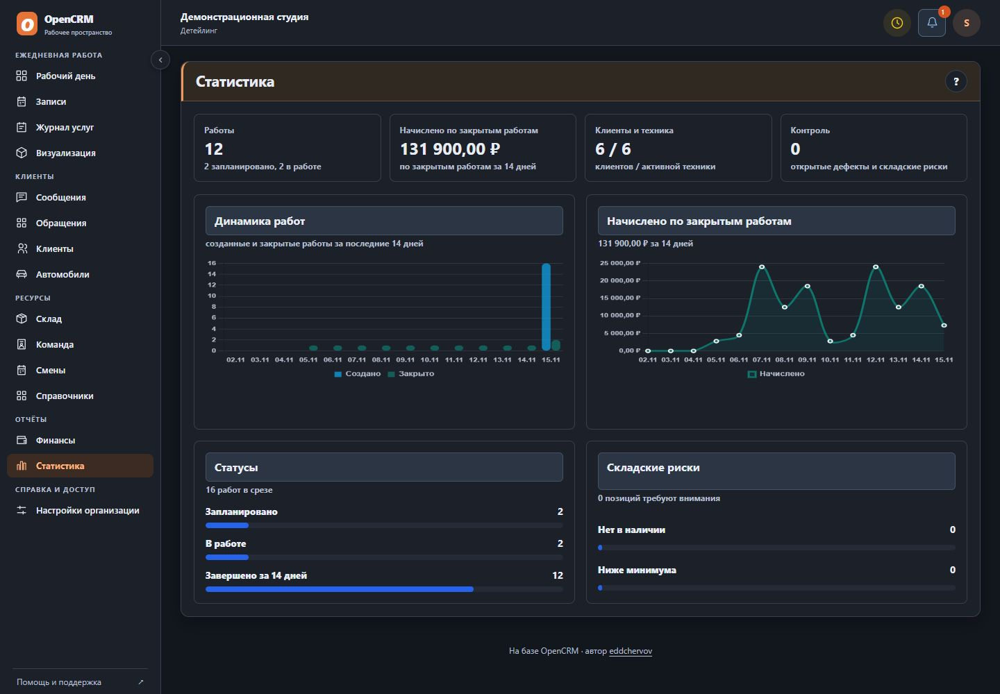
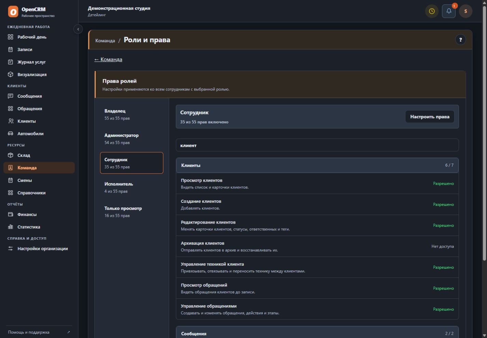
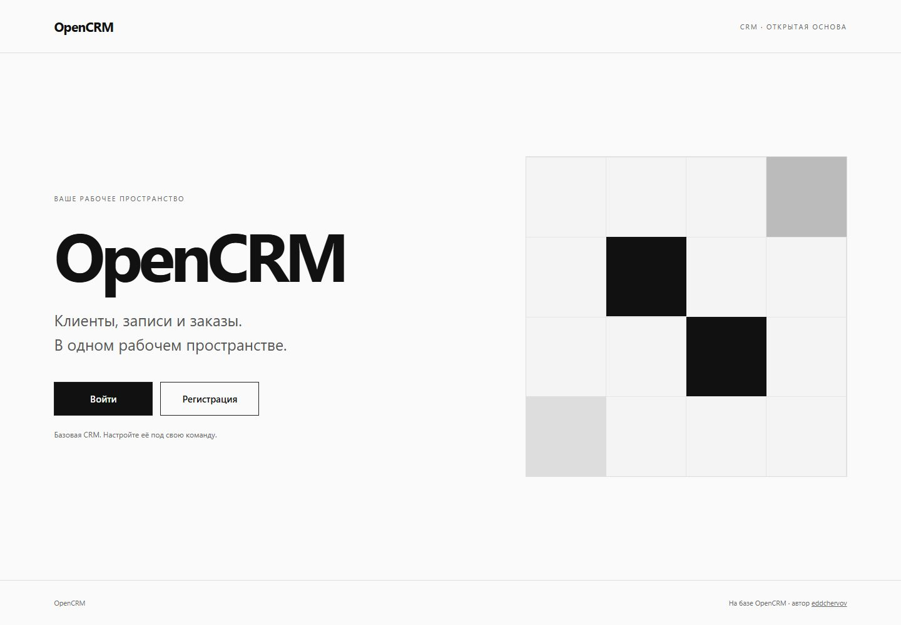
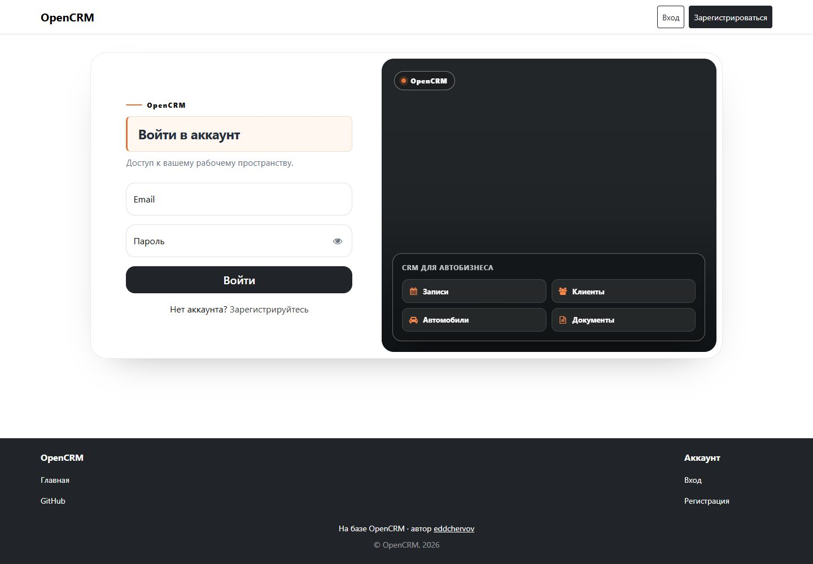

# OpenCRM 界面截图

[English](screenshots.md) | [Русский](screenshots.ru.md) | **简体中文**

截图来自本地运行的 OpenCRM，使用虚构的客户、车辆、金额和业务记录，商业模式已关闭。画面为俄语界面，图注为简体中文。点击图片可查看原图。

## 工作看板

四个阶段集中显示已预约、施工中、待交车和已交车的订单。演示组织设置了三个作业区。

同一个工作看板的浅色主题

## 客户

通过搜索和筛选查找客户，查看其车辆数量与到店记录。演示客户带有明确标记。

## 工位预约

时间网格按工位排列已计划、施工中、待交车和已交车的订单。截图下方还有其他时间段。

## 维修工单

工单汇总车辆、业务阶段、服务项目、客户信息和收款情况。页面下方还有其他区域。

## 接车检查

从四个视角记录车况与损伤。示例使用通用车辆示意图，并展示相关单据。

## 客户咨询

看板包含新咨询、确认需求、报价和可预约四个阶段。工位和时间须另行预约。

咨询详情包含客户需求、下一步操作和历史记录。示例邮件地址使用保留的 `example.invalid` 域名。

## 运营统计

查看已完成的作业、金额、客户、车辆和当前状态。

## 角色与权限

内置角色各有一套权限。图中选择员工角色并筛选与客户相关的权限。

## 公开页面

部署团队可在默认首页的基础上设置自己的品牌和内容。

基本配置支持密码登录，无需邮件投递服务。图中登录表单为空。

## 截图来源

截图保留了原始应用界面。演示数据库的设置和凭据保存在仓库外。早期[咨询设计说明（英文）](inquiries-design.md)中的示意图用于解释设计。

[项目概览](../README.zh-CN.md) · [文档索引](README.zh-CN.md) · [本地部署](local-run.zh-CN.md)
