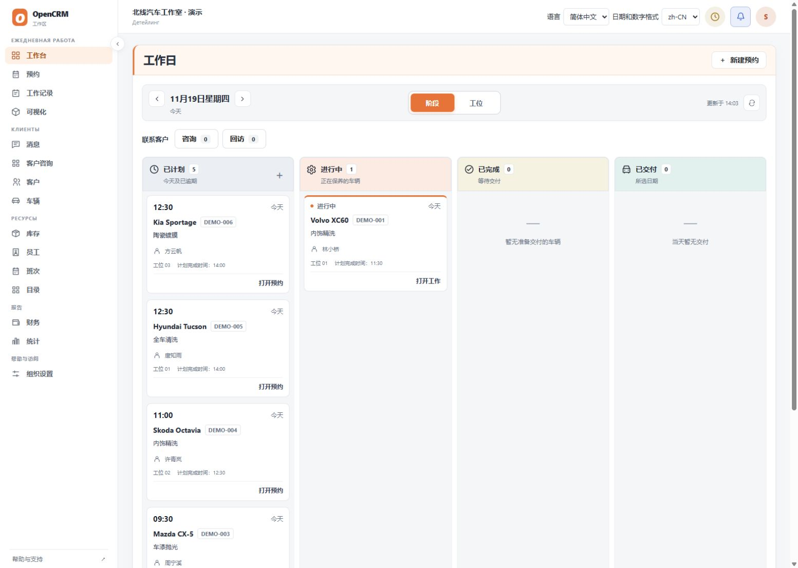
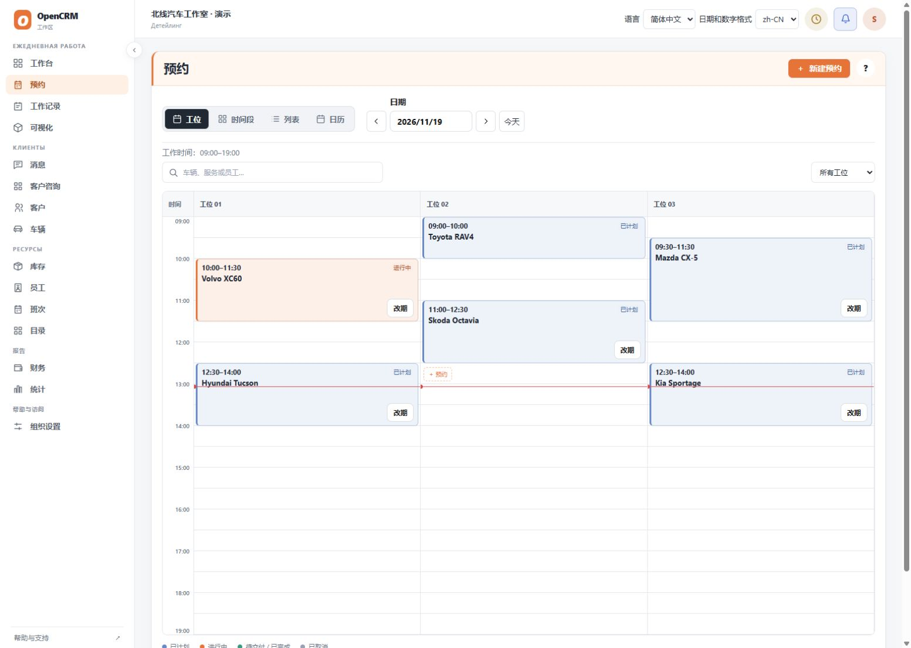
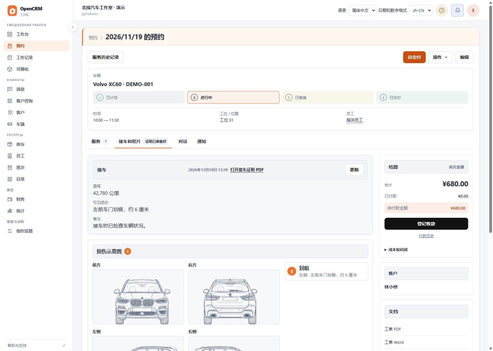

# OpenCRM 界面截图

[English](screenshots.md) | [Русский](screenshots.ru.md) | **简体中文**

截图来自本地运行的 OpenCRM。界面为简体中文，虚构门店以人民币（CNY）记账。演示车牌以 `DEMO-` 开头，电话和车辆识别代号（VIN）留空。

## 工作日看板

在同一看板查看计划中的预约和进行中的作业。

## 工位预约排班

三个工位上安排了六条演示预约。

## 接车与损伤示意图

沃尔沃 XC60 的接车记录标记了左侧的一处划痕。

## 维修工单

工单显示服务项目、当前阶段和人民币应收金额。

[项目概览](../README.zh-CN.md) · [文档索引](README.zh-CN.md) · [本地部署](local-run.zh-CN.md)
